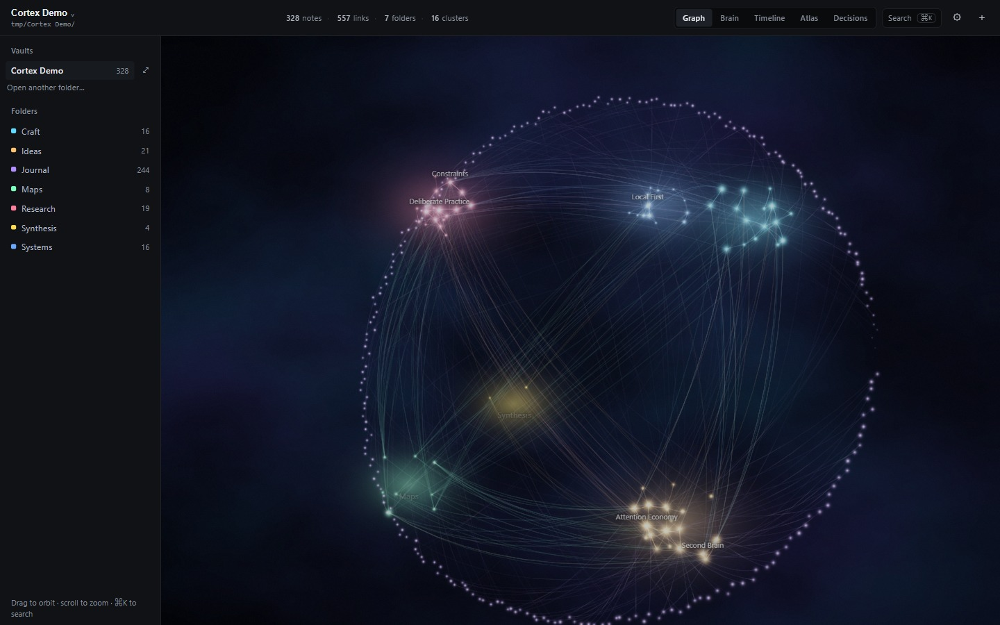
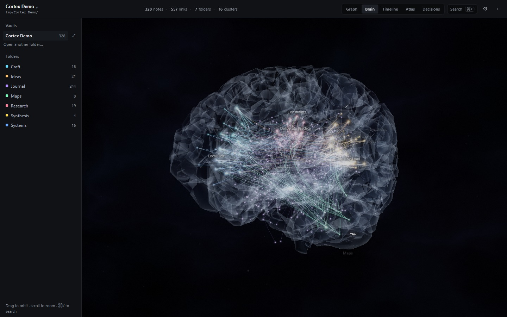
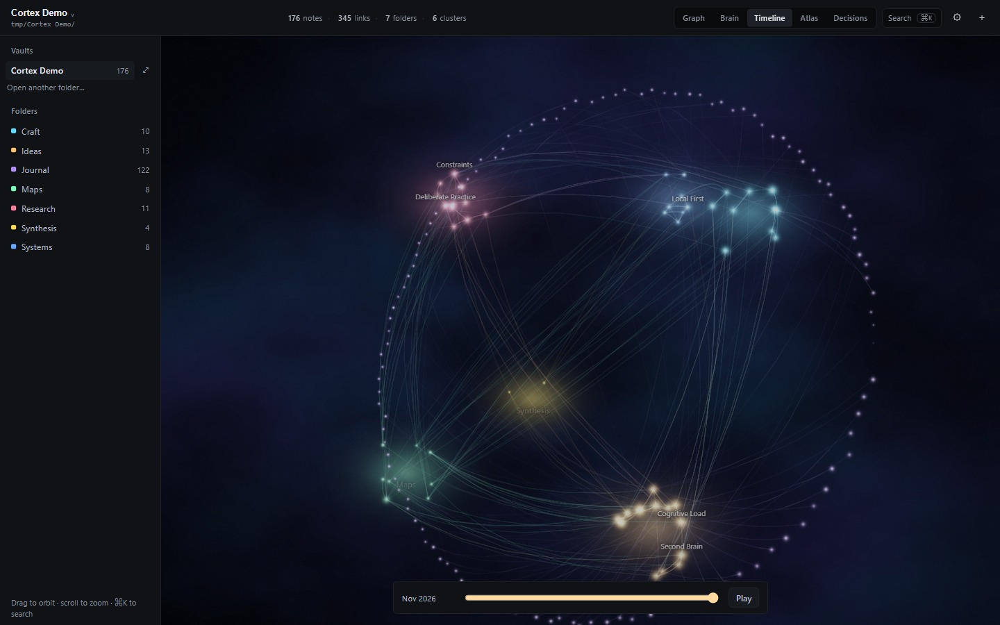
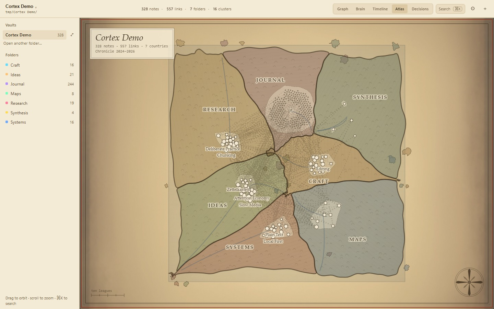
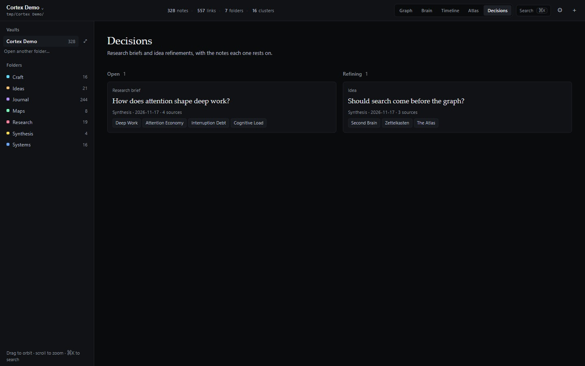

# Cortex

Cortex turns a folder of Markdown notes into a navigable 3D universe — and then
gives that view a job: collect notes, read their local graph, and turn the
selection into a research brief or an idea decision.

Four views share one graph: a 3D **universe**, a **brain**, a **timeline**, and
an **atlas** that draws folders as countries on a parchment map and links as
roads. Same notes, different question: where does this live, and what connects
to it? A fifth, **Decisions**, steps out of the graph: it lists the research
briefs and idea refinements you have written, grouped by status, with the notes
each one cites.

It reads and writes plain Markdown, so an existing Obsidian or Logseq vault
works as-is. No account, no cloud, no database.

## The five views

The seeded demo vault, 328 notes — same graph, five ways to ask about it.

| | |
| --- | --- |
|  |  |
| **Graph** — notes are stars, links are light. Drag to orbit, scroll to zoom, `f` to reframe. | **Brain** — the same graph laid out as two hemispheres, for seeing clusters instead of single notes. |
|  |  |
| **Timeline** — the vault replayed in the order it was written, with a scrubber that goes anywhere. | **Atlas** — folders as countries, notes as places, links as roads, on a map that never moves. |
|  | |
| **Decisions** — research briefs and idea refinements, grouped by `status`, with the notes each one cites. | Read-only on purpose: `status` stays your frontmatter, editable in Obsidian or by an agent. |

```bash
cargo run -p cortex                       # reopens the last vault, or offers a picker
cargo run -p cortex -- seed-demo demo     # optional: a 328-note example vault
cargo run -p cortex -- serve demo         # open one folder directly
```

## Opening a folder

Run `cortex` (or the Start Menu shortcut) and it reopens whatever you used
last. With nothing remembered you get a launch screen: the folders you have
opened before, **Browse…** for the platform's folder dialog, and a path field
for the places a dialog cannot reach (a network share, a WSL path, another
drive).

- Vaults are remembered in `vaults.json` in your platform config directory
  (`$XDG_CONFIG_HOME/cortex`, `~/Library/Application Support/cortex`,
  `%APPDATA%\cortex`). Override it with `CORTEX_CONFIG_DIR`.
- Several vaults can stay open at once. The list on the left switches between
  them without restarting anything; search, synthesis and the palette always
  act on the vault you are looking at.
- Choose the view you land in on the launch screen (**Open in**), or change it
  later from **Vault settings**. Cortex remembers the view per vault.
- `cortex serve <folder>` still opens one in the foreground, and `Ctrl+O`
  (`⌘O` on macOS) returns to the picker. Closing the app window ends the
  background instance; `cortex stop` does it from a terminal, and
  `cortex doctor` says what is running, on which port, with which browser.
- Nothing is copied, moved or synced. Cortex reads the folder in place, and a
  folder that has been moved shows up struck through until you forget it.

### Live updates

A change on disk — your editor, a sync client, another machine — appears in
about 400 ms. Only the changed files are re-parsed, and every note that still
exists keeps its position, so the universe does not rearrange itself while you
work. The tab is notified over a long poll: no refresh button, no page reload.
If the change lands in the note you are editing, Cortex warns instead of
replacing your draft.

## The research loop

1. **Collect evidence.** ⌘-click (or shift-click) stars, or press `Collect` in a
   note panel. Collected stars stay bright while everything else dims.
2. **Read the neighbourhood.** Opening a note focuses its local graph: only the
   note, its backlinks and its direct neighbours keep their labels.
3. **Make the structure note.** `Research brief` asks for the question and writes
   `Synthesis/<question>.md` with frontmatter, a linked evidence list (title,
   folder, excerpt) and sections for what the sources say, tensions, synthesis
   and open questions.

Every claim in the brief is one click from its source, because the evidence
list is made of `[[wikilinks]]`, not copies — and the brief itself joins the
**Decisions** view, under `open`, with those sources on the card.

## The idea-refinement loop

Select the notes that carry the tension, then choose `Refine idea`. The scaffold
has situation, assumptions (load-bearing vs cosmetic), two options with effort /
risk / reversibility, a recommendation, and "what would change my mind".

This is the part most note tools leave out: they help you collect and connect,
then stop before a decision exists. Cortex makes the decision artifact a
first-class note in the same graph, and keeps it in **Decisions** until its
`status` says otherwise.

## The atlas

The fourth view is a campaign map for history and worldbuilding: folders become
countries, notes become places inside them, links become roads.

- **Geography is deterministic.** The same vault always grows the same map, so
  a place stays where you learned it.
- **Borders are shared.** Country outlines are grown from a partition of the
  folder centres and roughened with noise keyed to the *unordered* endpoints of
  each border segment, so two neighbouring countries displace their shared
  border to the same line instead of leaving a seam.
- **Wilderness is the default.** Land nobody settled is stippled with grass;
  each clump of notes gets a walled enclosure with cleared ground inside it.
- **Roads carry weight.** Every link draws a road. A note with more links draws
  a wider road, and a link that crosses a border becomes a dashed trade route.
- **Sea, islands, compass.** The land is pulled in from the frame, ringed with
  a fine sea wash, and dotted with small islands off the coasts.

Drag to pan, wheel or `+`/`-` to zoom, `0` to fit, arrow keys to pan with the
keyboard, click a place to open it. Hiding a folder dims its country and its
roads rather than deleting them.

## Decisions

The fifth view answers a different question: *what have I concluded, and on
what?* Every note with `type: research` or `type: idea` — the two kinds Cortex
writes — appears as a card, grouped by its `status`.

- `open` and `refining` are the columns Cortex creates. Any other value you
  write in frontmatter becomes its own column, so `answered` or `parked` works
  without Cortex pretending to know what it means.
- A card shows its folder, its date, how many notes it cites, and those notes as
  chips. Click a chip to open the source; click the title to read or edit the
  brief.
- Links that point nowhere are counted on the card instead of being hidden.
- The board is read-only on purpose. `status` is your frontmatter, editable in
  Obsidian, another editor or by an agent: Cortex reports it and does not take
  the field over. Obsidian's Bases already moves cards between columns; what it
  cannot do is show the evidence a decision rests on.
- Empty is a real state. Until you write a brief, the view explains the loop
  instead of pretending to have data.

The board is built from the same vault scan as the graph, so it updates on the
same live poll, works in `cortex export`, and costs one field in the graph
payload rather than a second index.

## Navigating

`Ctrl` on Windows and Linux, `⌘` on macOS.

| Action | Key |
| --- | --- |
| Search every note | `Ctrl K` / `⌘K`, or `/` |
| Back / forward through opened notes | `Ctrl [` / `Ctrl ]` (`⌘[` / `⌘]`), or `‹` `›` in the panel |
| Collect / uncollect a note | `Ctrl` / `⌘` / `Shift` + click, or `c` |
| Focus a note | click it (local graph only) |
| Views | `1` graph, `2` brain, `3` timeline, `4` atlas, `5` decisions |
| Reset camera | `f` |
| New note / edit | `n`, or `Edit` in the panel |
| Open another folder | `Ctrl O` / `⌘O` |

The folder list toggles visibility; hidden folders dim instead of disappearing,
so the context stays visible. Clicking a `[[link]]`, a backlink or an unlinked
mention opens that note in place, and the arrows walk back through the chain.

## Vault settings

The gear in the toolbar holds the per-vault decisions:

- **Opens in** — which view this vault should start in.
- **Show in folder** — hands the folder to Explorer, Finder or your file
  manager. The same button (⤢) sits beside every vault in the sidebar.
- **Map** — roads and trade routes on the atlas.
- **Agent access** — whether AI clients may read and write this vault.

## Agents (MCP)

Cortex ships a Model Context Protocol server, so the AI client you already use
can read the vault, create notes and rewrite sections — through the same guards
the app enforces.

```bash
cortex mcp ~/Notes                    # stdio MCP server bound to one vault
cortex mcp-config --vault ~/Notes     # the snippet, with this binary and this folder
cortex mcp-config --vault ~/Notes --write   # merge it into Claude Desktop and Cursor
```

The printed JSON contains the absolute path to the binary **and** the folder,
so the copy-paste version works. `--write` merges `mcpServers.cortex` into
Claude Desktop and Cursor, backing the file up first and leaving every other
key alone; Zed and everything else get the snippet to paste. Cortex has no
approval step of its own: the AI client decides whether to trust a server, and
most clients only read their config at startup — **restart the client** after
adding it. Vault settings → **AI clients** has the same snippet, a status line
for each client, and **Test connection**, which really starts `cortex mcp`,
initializes it and lists its tools.

Without an argument `cortex mcp` binds to the vault you opened last.

| Tool | What it does |
| --- | --- |
| `cortex_guide` | House format and the rules; an agent should read it first |
| `cortex_stats` | Note and link counts, folders, orphans, unresolved links |
| `cortex_search` | Full-text search with snippets |
| `cortex_read_note` | Body, tags, headings, and the hash a write needs |
| `cortex_create_note` | New note in a folder, slugged from the title |
| `cortex_write_note` | Replace a whole body (`expect` required) |
| `cortex_replace_section` | Replace one section, keep the rest |
| `cortex_append` | Add a block at the end |
| `cortex_move_note` | Rename or refile a note |
| `cortex_links` | Backlinks, outgoing links, unlinked mentions |
| `cortex_orphans` | Notes with no links in either direction |
| `cortex_list_vaults`, `cortex_use_vault` | Same process, another folder |

Every write must present the hash from `cortex_read_note`. If the file changed
in between, the write fails with a conflict and the current hash instead of
clobbering the note you have open in Obsidian. There is no delete tool,
`.obsidian/` and paths outside the vault are refused, and each write is
appended to `agent-writes.jsonl` in the config directory. The instructions an
agent actually receives are in `docs/agent-guide.md`; the reasoning is in
[ADR 0003](docs/adr/0003-agent-access.md).

Access is a per-vault switch. It is on for a vault you have opened in Cortex and
off for a folder Cortex has never seen, so naming a path on the command line is
not a way around it. Turn it off in vault settings, or with
`cortex agents ~/Notes --off`; `cortex mcp` then refuses to start, and a client
that is already connected is stopped on its next call. Turning it back on needs
one of those two, not a restart.

## Run it on your own vault

```bash
cargo run -p cortex -- serve ~/Notes --title "My vault"
```

| Flag | Meaning |
| --- | --- |
| `--open` | open the UI in your browser once the server is up |
| `--app` | open a chromeless app window (Chrome, Edge, Brave) instead of a tab |
| `--read-only` | serve without write endpoints (switching folders still works) |
| `--bind 0.0.0.0` | expose on the LAN (loopback is the default) |
| `--allow-any-origin` | relax the same-origin check (LAN preview) |
| `--allow-framing` | allow embedding in an iframe |
| `--port` | default 3000 |

`cortex export <vault> --out dist` writes a static, read-only site plus
`graph.json` (note bodies included). `cortex index <vault>` prints vault health.

Because opening a folder reads it, it is gated by the `x-cortex` write header
and the same-origin check rather than by `--read-only`. Combined with
`--allow-any-origin` that means anyone who can reach the server can point it at
any folder the process can read — which is why the default is loopback-only.

## Download (Windows first)

**Installer:** `CortexSetup-<version>.exe` — per user, no admin, Start Menu
entry, uninstaller, optional start-at-login. **Portable:**
`cortex-windows-x86_64.zip`, unpack and run `cortex.exe`. Both from
https://github.com/thijnperd/obsidian-cortex/releases

| Platform | File |
| --- | --- |
| Windows x86-64 | `CortexSetup-<version>.exe` or `cortex-windows-x86_64.zip` |
| macOS (Apple silicon) | `cortex-macos-arm64.tar.gz` |
| Linux x86-64 | `cortex-linux-x86_64.tar.gz` |

Tagged releases (`v0.4.0`) are fixed; every push to `main` also refreshes the
rolling `latest` build. The version appears in `cortex --version`, in **Vault
settings → About**, and on `/api/about`. `SHA256SUMS.txt` is attached to every
release.

### Windows says it is unsafe

The executable is unsigned, so SmartScreen shows *Windows protected your PC* on
the first run: **More info → Run anyway**. There is no auto-update yet;
**Check for updates** in About opens the release page. The full walk through,
including uninstall and checksum verification, is in
[installing on Windows](docs/install-windows.md).

### What starts when you run `cortex`

One process owns the server, the window and (on Windows and macOS) the tray
icon. It starts in the background, so the terminal comes straight back and
closing it changes nothing. Closing the window ends the instance; **Quit
Cortex** in the tray does the same. If port 3000 is taken it takes the next free
port, records it in `server.json`, and a second launch opens a window against
the running instance instead of dying on a bind error. `cortex stop` ends it,
`cortex doctor` explains it.

The window is Chrome, Edge or Brave in `--app` mode with a profile of its own —
a chromeless window without shipping a second runtime. Without one of those
browsers you get a normal tab, and closing that tab cannot end the instance, so
use the tray or `cortex stop`. Linux has no tray: it runs until `cortex stop`.

Or point it straight at a folder, in the foreground:

```bash
cortex serve ~/Documents/MyVault --open
```

## Design constraints

- **The files are the app.** Frontmatter, wikilinks, tags and headings are the
  only schema; no proprietary format. Deleting the vault is the uninstall.
- **The graph must earn its place.** It is for orphans, clusters, and local
  neighbourhoods — not for reading the whole vault at once. That is why focus
  and filters exist.
- **Writes are opt-in.** Loopback by default, custom header plus exact-origin
  check, path validation, atomic writes, 1 MiB caps, strict CSP.
- **Deterministic.** Same vault, same layout, so places stay memorable.

## Develop

```bash
cargo test -p cortex-core
cargo clippy --workspace --all-targets -- -D warnings
cargo fmt --all --check
```

## When something is wrong

```bash
cortex doctor     # version, config and log paths, live instance, port,
                  # browser, every vault and its agent switch, MCP clients
cortex stop       # ask the background instance to exit
```

The background process writes `<config>/cortex.log`; the tray's **Show log**
opens it, and it rotates once at 1 MiB. A busy port is no longer an error: the
next free one is chosen and printed. If `cortex` says nothing at all, run
`cortex app` in a terminal — it is the same process with its output attached.

The workflow design is grounded in primary documentation from Obsidian,
Logseq, Heptabase, Roam, Zettelkasten and Forte Labs; the notes and sources are
in [`docs/research-workflows.md`](docs/research-workflows.md).

`crates/core` is pure logic (parse, index, layout, search, synthesis);
`crates/server` is axum plus the embedded `web/` UI, which is hand-written
WebGL2 with no build step. CI runs the checks on Linux, macOS and Windows and
publishes the static export to GitHub Pages.

## Credits

The Brain view's cortical surface is a simplified version of the
[Detailed Human Brain Model](https://3d.nih.gov/entries/3DPX-021161) from NIH 3D
(Johnson J), used under [CC BY 4.0](https://creativecommons.org/licenses/by/4.0/).
It was reduced from 377,701 to 20,018 triangles for the renderer.
