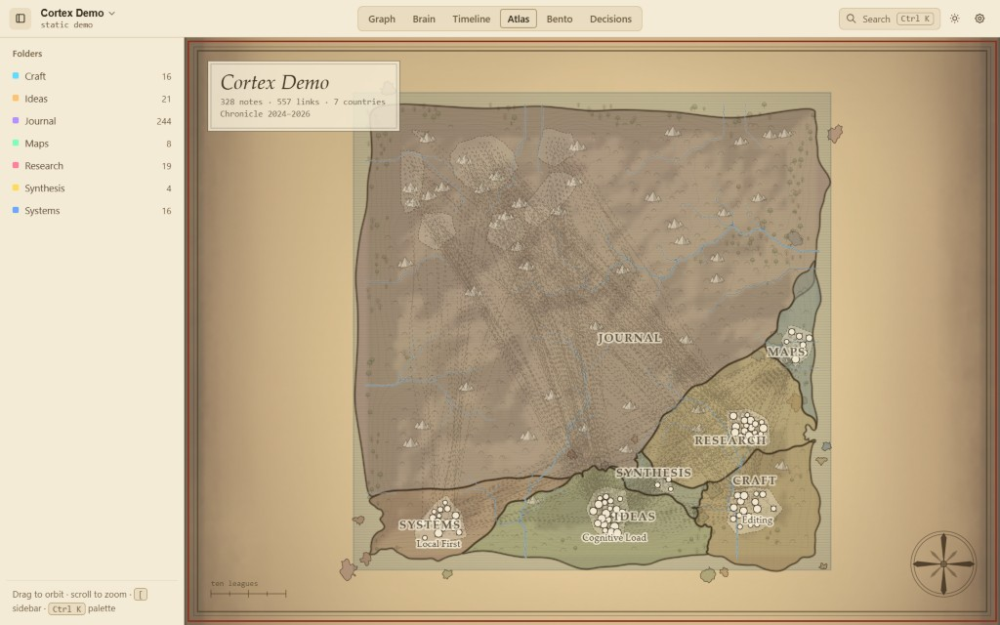
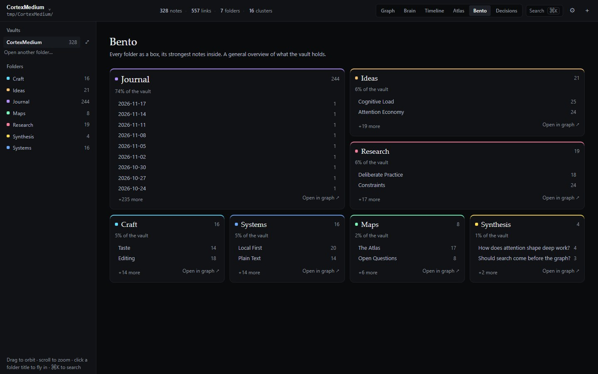
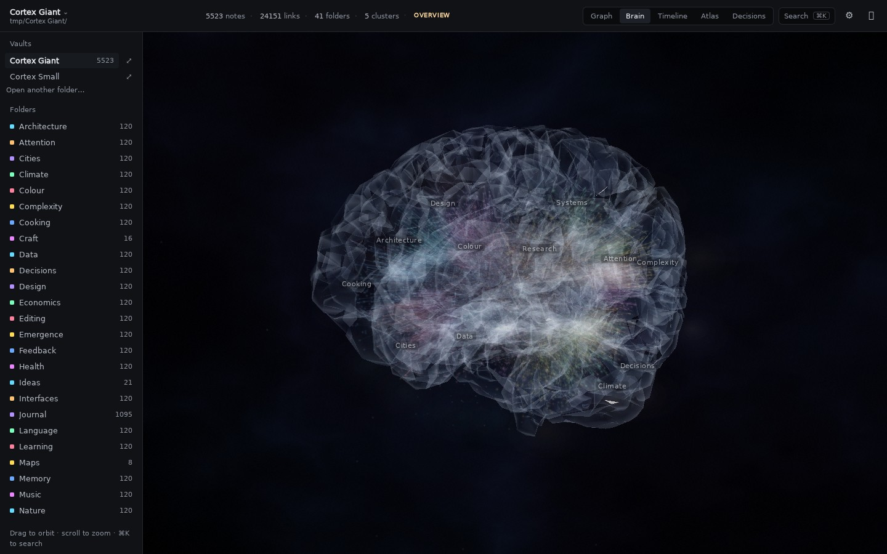
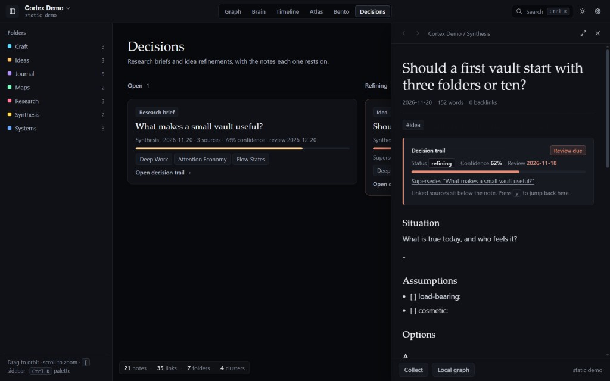

<p align="center">
  
</p>

<h1 align="center">Cortex</h1>

<p align="center"><strong>Your notes, as a brain.</strong></p>

<p align="center">
  <a href="https://thijnperd.github.io/obsidian-cortex/demo/?view=brain">
    
  </a>
</p>

<p align="center"><em>The Brain view of a 328-note vault: 557 links on one cortical surface.</em></p>

<p align="center">
  <a href="https://thijnperd.github.io/obsidian-cortex/"><strong>Visit the product page</strong></a> ·
  <a href="https://thijnperd.github.io/obsidian-cortex/demo/?view=brain"><strong>Open the live demo</strong></a> — 332 notes, opens in the Brain, no install.
</p>

<p align="center">
  <a href="https://github.com/thijnperd/obsidian-cortex/releases"></a>
  
  
</p>

Cortex reads a folder of Markdown and draws it as a brain. Folders become
regions on a cortical surface, notes become stars, and wikilinks become fibre
tracts you can follow with the mouse.

It is the same vault scan behind six views. The layout is deterministic, so a
folder stays where you learned it, and switching from Brain to Graph to Timeline
changes the lens rather than the data.

On Windows and macOS it is a desktop app: a WebView2 or WKWebView window with a
tray icon and no browser profile behind it. On Linux it serves the UI to your
browser and the binary stays self-contained.

No account, no cloud, no database, no model required. Your files stay where they
are; deleting the folder is the uninstall.

**Most tools help you collect. Cortex compares your sources and keeps the reasoning.**

## Install

| Platform | File |
| --- | --- |
| Windows x86-64 | `CortexSetup-2.5.1.exe`, or `cortex-windows-x86_64.zip` to run unpacked |
| macOS (Apple silicon) | `Cortex.app` inside `cortex-macos-arm64.tar.gz` |
| Linux x86-64 | `cortex-linux-x86_64.tar.gz` |

Download from [Releases](https://github.com/thijnperd/obsidian-cortex/releases).
`SHA256SUMS.txt` is attached to every release. The Windows installer is per
user, needs no admin rights, and adds a Start Menu entry and an uninstaller.

The executable is unsigned, so SmartScreen shows *Windows protected your PC* on
first run: **More info → Run anyway**. The longer walk through, including
checksum verification, is in [installing on Windows](docs/install-windows.md).

### From source

```bash
cargo run -p cortex                                  # last vault, or the picker
cargo run -p cortex -- seed-demo demo --size small   # 21 notes
cargo run -p cortex -- seed-demo demo --size medium  # 332 notes
cargo run -p cortex -- seed-demo demo --size large   # ~5,600-note synthetic stress test
cargo run -p cortex -- serve demo                    # open that folder directly
```

`seed-demo` writes the demo vault from the binary itself. Nothing is downloaded.

### First five minutes

1. Run `cortex`. With nothing remembered you get a launch screen: recent
   folders, **Browse…**, and a path field for network shares and WSL paths.
2. Pick a folder of Markdown. Obsidian and Logseq vaults open as they are.
3. The Brain appears. Drag to orbit, scroll to zoom, click a folder name to fly
   into it, press `f` to reframe.
4. Press **Tour** for the fifteen-step walkthrough. If your vault lacks the
   notes it teaches, it opens a generated demo and returns you afterwards
   without writing to your files.
5. Press `t` for today's note, `Ctrl K` to search, `1`–`6` to change view.

## Why a brain

Every knowledge tool draws a graph. A graph is a useful picture and a generic
one: dots and lines, the same everywhere. Cortex is named after the cortex
because a folded surface is a better memory palace than a scatter plot.

The Brain gives each folder a region and keeps the strongest links close. Under
it is the graph payload, the same search and the same notes, so the brain is a
front door rather than a separate product. Switch to Graph and the clusters are
still there, unwrapped.

## Six views

The same vault across six lenses. Every screenshot in this README is rendered
by the app from a seeded vault.

| | |
| --- | --- |
|  |  |
| **Brain** — the graph folded onto a cortical surface, links as fibre tracts. | **Graph** — folder galaxies; drag to orbit, scroll to zoom, `f` to reframe. |
|  |  |
| **Timeline** — the vault replayed in the order you wrote it. | **Atlas** — folders as countries, notes as places, links as roads. |
|  |  |
| **Bento** — every folder as a box, sized by how much of the vault it holds. | **Decisions** — briefs and idea notes grouped by `status`, with their sources. |

Above 1,200 notes the graph switches to a folder-level overview: notes keep their
positions, folders get the labels, only the strongest 5,000 links draw, and dense
folders become stipple on the atlas. Hover or select a note for its own label.

### Synthetic scale stress test (~5,600 notes)



The `--size large` vault is a **synthetic generator stress test** (not a real
user vault): 41 varied-size topic folders, a three-year daily journal, and 24
generated decision briefs. It exists to benchmark rendering and indexing at
~5,600 notes, where a three-year daily journal becomes a ring around the vault
instead of a blob that swallows it.


The atlas sizes each country by its note count and turns a 1,095-note journal
into stipple rather than a wall of markers. Rivers, roads, contours and forests
are all drawn from one height model, so the terrain matches the land.

The small demo (21 notes) is the first-run taste: `seed-demo demo --size small`.

## Decisions, and the trail

<p align="center">
  
</p>

A decision here is not a note with a checkbox. It carries a confidence level, a
date to look at it again, and a predecessor it supersedes. Cortex keeps that in
plain frontmatter, so it survives every editor and every sync folder.

```yaml
---
type: idea
status: accepted
confidence: 0.8
review_on: 2027-01-15
supersedes: "[[Earlier decision]]"
---
```

All three fields are optional, and the board is read-only on purpose: `status`
is your frontmatter, editable in Obsidian or by an agent. Any value you write
becomes its own column, so `answered` and `parked` work without Cortex guessing
what they mean. A past `review_on` date is marked **Review due** and shows up on
the board; press `y` in the note to see the trail, its linked sources and the
note it replaces.

### Research briefs and idea notes

Select two or more notes, then choose **Research brief** or **Refine idea** in
the Collected tray. Cortex writes `Synthesis/<question>.md`: ordinary Markdown
with frontmatter, deterministic cross-source analysis, and an evidence list of
`[[wikilinks]]`.

No LLM, prompt, or API key is involved. Instead of writing fake conclusions for
you, Cortex compares the collected notes locally and extracts:

- **Source comparison:** date span, shared tags, shared outgoing references,
  direct links between selected notes, and unlinked overlaps that share a tag or
  reference without linking yet.
- **Line-cited claims (`L#`):** substantive prose lines pulled from each source
  note with exact line references.
- **Flagged tensions & open questions:** contrast/caveat lines (`however`,
  `whereas`, `risk`, `trade-off`, `fails`) and open checkboxes/questions
  extracted from the sources.

Because every claim and citation uses `[[wikilinks]]`, each brief joins the
Decisions board with clickable sources while leaving the judgment to you (or an
MCP-connected client).

`Refine idea` seeds situation, load-bearing vs cosmetic assumptions, two options
with effort, risk and reversibility, a recommendation section, and "what would
change my mind".

## Agent-safe MCP

Cortex has no built-in model and works completely standalone without an AI
client. When you *do* want Claude Desktop, Cursor, or Zed to read and edit
notes, Cortex ships a Model Context Protocol server over stdio with guardrails
built around real vaults:

```bash
cortex mcp ~/Notes                          # stdio MCP server bound to one vault
cortex mcp-config --vault ~/Notes           # the snippet, with this binary and folder
cortex mcp-config --vault ~/Notes --write   # merge it into Claude Desktop and Cursor
```

`--write` backs up the config first and leaves every other key alone; Zed and
anything else get the snippet to paste. Cortex has no approval step of its own:
the client decides whether to trust a server, and most clients only read their
config at startup, so restart the client afterwards. Vault settings → **AI
clients** shows the snippet, a status line per client, and **Test connection**.

| Tool | What it does |
| --- | --- |
| `cortex_guide` | House format and rules; an agent reads this first |
| `cortex_stats` | Note and link counts, folders, orphans, unresolved links |
| `cortex_search` | Full-text search with snippets |
| `cortex_read_note` | Body, tags, headings, and the hash a write needs |
| `cortex_create_note` | New note in a folder, slugged from the title |
| `cortex_write_note` | Replace a whole body (`expect` required) |
| `cortex_replace_section` | Replace one section, keep the rest |
| `cortex_append` | Add a block at the end |
| `cortex_move_note` | Rename or refile a note |
| `cortex_links` | Backlinks, outgoing links, unlinked mentions |
| `cortex_orphans` | Notes with no links in either direction |
| `cortex_list_vaults`, `cortex_use_vault` | Same process, another folder |

Every write must present the hash from `cortex_read_note`. If the file changed
in between, the write fails with a conflict and the current hash instead of
clobbering the note you have open in Obsidian. There is no delete tool,
`.obsidian/` and paths outside the vault are refused, and each write is appended
to `agent-writes.jsonl` in the config directory.

Access is a per-vault switch: on for a vault you have opened in Cortex, off for a
folder Cortex has never seen, so naming a path on the command line is not a way
around it. Turn it off in vault settings or with `cortex agents ~/Notes --off`;
a connected client stops on its next call. The instructions an agent receives are
in [docs/agent-guide.md](docs/agent-guide.md), the reasoning in
[ADR 0003](docs/adr/0003-agent-access.md).

## Navigating

`Ctrl` on Windows and Linux, `⌘` on macOS. The app names the keys of the OS you
are on rather than showing both.

| Action | Key |
| --- | --- |
| Command palette &amp; note search | `Ctrl K` / `⌘K`, or `/` (`>` for commands only) |
| Toggle sidebar | `[` |
| Back / forward through opened notes | `Ctrl [` / `Ctrl ]` (`⌘[` / `⌘]`), or `‹` `›` |
| Collect / uncollect a note | `Ctrl` / `⌘` / `Shift` + click, or `c` |
| Local neighbourhood | `Local graph` in the note panel, or `l` |
| Fly to a folder / back out | click its title, or `All folders` |
| Views | `1` graph, `2` brain, `3` timeline, `4` atlas, `5` decisions, `6` bento |
| Reset camera | `f` |
| New note / edit | `n`, or `Edit` in the panel |
| Today's note | `t`, or the sun button in the toolbar |
| Jump to a decision trail | `y` while a brief or idea note is open |
| Open another folder | `Ctrl O` / `⌘O` |

Hidden folders dim instead of disappearing, so the context stays on screen.
Clicking a `[[link]]`, a backlink or an unlinked mention opens that note in
place, and the arrows walk back through the chain.

## Notes studio

The **Notes** tab is a three-pane workspace for writing: a folder explorer (or
flat list) with a filter (All, Pinned, Recent or one folder; sort by recent, A-Z,
links or length), the editor, and a connections pane with backlinks, unlinked
mentions and related notes, each with a one-line snippet. **+ New** or `n`
starts a note; quick capture files a title straight into the Inbox. Everything
is still plain Markdown on disk.

## Editing

**Edit** opens the note as plain Markdown in a textarea. What you type is what
gets saved, frontmatter and wikilinks included.

| Action | Key |
| --- | --- |
| Save / cancel | `Ctrl S` or `Ctrl Enter` / `Esc` |
| Bold, italic, inline code | `Ctrl B`, `Ctrl I`, `Ctrl E` |
| Wikilink | select text, `Ctrl K` |
| Strikethrough, highlight, code block | `Ctrl Shift X`, `Ctrl Shift H`, `Ctrl Shift K` |
| Heading 1–3 | `Ctrl 1`, `Ctrl 2`, `Ctrl 3` |
| Ordered / bullet / task list | `Ctrl Shift 7`, `Ctrl Shift 8`, `Ctrl Shift 9` |
| Blockquote | `Ctrl Shift .` |
| Indent / outdent | `Tab` / `Shift Tab` |
| Toggle task checkbox | `Ctrl L`, or `Ctrl Enter` on a task line |
| Duplicate line or selection | `Ctrl Shift D` |
| Move line up / down | `Alt Up` / `Alt Down` |
| Insert block | `/` at the start of a line: headings, tasks, tally boxes, callouts, table, math, code, quote, divider, today's date, wikilink |
| Shortcut cheat sheet | `?` |

`⌘` replaces `Ctrl` on macOS. Typing `[` inserts `[]` with the caret inside;
parentheses, braces and quotes do the same. Typing a closing character in front
of one steps over it instead of duplicating it.

Today's note is a normal file at `Journal/YYYY-MM-DD.md`. Cortex opens an
existing one rather than replacing it; a new one starts with Notes, Decisions
and Tomorrow headings.

## Vault settings

The gear in the toolbar holds the per-vault choices: **Opens in** (which view
this vault starts in), **Show in folder** (hands the path to Explorer, Finder or
your file manager), **Map** (roads and trade routes on the atlas) and **Agent
access** (the MCP permission described above).

## Several folders at once

Vaults are remembered in `vaults.json` under your platform config directory
(`$XDG_CONFIG_HOME/cortex`, `~/Library/Application Support/cortex`,
`%APPDATA%\cortex`), overridable with `CORTEX_CONFIG_DIR`. The sidebar switches
between open vaults without restarting; search, briefs and the palette act on the
vault you are looking at. Nothing is copied, moved or synced, and a folder that
has been moved shows up struck through until you forget it.

A change on disk appears in about 400 ms. Only the changed files are re-parsed,
and notes that still exist keep their positions, so the graph does not rearrange
itself while you work. If the change lands in the note you are editing, Cortex
warns instead of replacing your draft.

## Run it on your own vault

```bash
cortex serve ~/Notes --title "My vault"
```

| Flag | Meaning |
| --- | --- |
| `--open` | open the UI in your browser once the server is up |
| `--app` | `serve` only: open a chromeless browser window instead of a tab |
| `--read-only` | serve without write endpoints |
| `--offline` | disable all outbound network requests (including the update check) |
| `--bind 0.0.0.0` | expose on the LAN (loopback is the default) |
| `--allow-any-origin` | relax the same-origin check (LAN preview) |
| `--allow-framing` | allow embedding in an iframe |
| `--port` | default 3000 |

`cortex export <vault> --out dist` writes a static, read-only site plus
`graph.json`; `cortex index <vault>` prints vault health.

Opening a folder reads it, so it is gated by the `x-cortex` write header and the
same-origin check rather than by `--read-only`. With `--allow-any-origin`,
anyone who can reach the server can point it at any folder the process can read.
That is why the default is loopback-only.

### Updates and process lifetime

Cortex checks its public GitHub release feed once at startup and from **Check
for updates** in About. Uncheck **Check for updates automatically on launch** in
Vault settings → About to opt out, or start with `--offline` (or
`CORTEX_OFFLINE=1`) to block all outbound requests. The Windows path downloads the
installer, verifies it against that release's `SHA256SUMS.txt`, runs it and
reopens Cortex; it never installs a build whose checksum does not match. macOS
and Linux open the release page, because replacing a running Unix binary safely
needs its own mechanism.

One process owns the server, the window and (on Windows and macOS) the tray. It
starts in the background, so the terminal comes back and closing it changes
nothing. If port 3000 is taken it uses the next free port, records it in
`server.json`, and a second launch opens a window against the running instance.
`cortex stop` ends it; `cortex doctor` explains it.

On Linux, Cortex uses Chrome, Edge or Brave in `--app` mode, otherwise a normal
tab. It has no tray, so it runs until `cortex stop`. Linking WebKitGTK, GTK and
libsoup through wry would give up a currently self-contained binary, and that
trade is left to a later release ([ADR 0009](docs/adr/0009-native-window.md)).

## Design constraints

- **The files are the app.** Frontmatter, wikilinks, tags and headings are the
  only schema. Deleting the vault is the uninstall.
- **The graph must earn its place.** It is for orphans, clusters and local
  neighbourhoods, not for reading the whole vault at once.
- **Writes are opt-in.** Loopback by default, custom header plus exact-origin
  check, path validation, atomic writes, 1 MiB caps, strict CSP.
- **Deterministic.** Same vault, same layout, so places stay memorable.

## Develop

```bash
cargo test --workspace --all-targets
cargo clippy --workspace --all-targets -- -D warnings
cargo fmt --all -- --check
node tools/check-repo.mjs
node --test tests/web.test.mjs
```

`crates/core` is pure logic: parse, index, layout, search, synthesis.
`crates/server` is axum plus the embedded `web/` UI, hand-written WebGL2 with no
build step. CI runs the Rust checks, JS unit tests, and a Playwright headless
smoke test on Linux and publishes the static export to the
[live demo](https://thijnperd.github.io/obsidian-cortex/).

## When something is wrong

```bash
cortex doctor     # version, config and log paths, live instance, port,
                  # webview, every vault and its agent switch, MCP clients
cortex stop       # ask the background instance to exit
```

The background process writes `<config>/cortex.log`; the tray's **Show log**
opens it, and it rotates once at 1 MiB. If `cortex` says nothing at all, run
`cortex app` in a terminal: same process, output attached.

## License

MIT. See [LICENSE](LICENSE); security reports follow [SECURITY.md](SECURITY.md),
and the 2.5.1 notes are in [docs/releases/v2.5.1.md](docs/releases/v2.5.1.md).
The in-app icons are [Tabler Icons](https://tabler.io/icons), MIT licensed, with
the notice in [THIRD_PARTY_NOTICES.md](THIRD_PARTY_NOTICES.md).

The Brain view's cortical surface is a reduced version of the
[Detailed Human Brain Model](https://3d.nih.gov/entries/3DPX-021161) from NIH 3D
(Johnson J), used under [CC BY 4.0](https://creativecommons.org/licenses/by/4.0/)
and cut from 377,701 triangles to 20,018.

The workflow design is grounded in primary documentation from Obsidian, Logseq,
Heptabase, Roam, Zettelkasten and Forte Labs; the notes and sources are in
[`docs/research-workflows.md`](docs/research-workflows.md). The README rewrite
follows [README and copy research](docs/research/readme-and-copy.md).
