<p align="center">
  <a href="https://github.com/thijnperd/obsidian-cortex/releases/tag/v1.1.1">
    
  </a>
</p>

<h1 align="center">Cortex 1.1.1 — The Guided Tour</h1>

<p align="center"><strong>Your notes have a shape. Cortex shows you the reason.</strong></p>

<p align="center">
  <a href="https://github.com/thijnperd/obsidian-cortex/releases/tag/v1.1.1"></a>
  
  
  
</p>

Cortex is a local-first thinking space for people who refuse to lose the
thread. Point it at a folder of Markdown and it turns what you already wrote
into six ways of seeing it — then keeps the part most tools throw away:
**why you decided what you decided.**

No account. No cloud. No database. No model required. Just your files, a graph
that earns its place, and a memory for judgment.

**Most tools help you collect. Cortex helps you conclude.**

- **See the shape.** A 3D universe, a brain, a timeline, an atlas and a bento
  board show the same notes from different angles. The graph is not decoration:
  it is how you find the cluster you forgot, the bridge between two projects,
  and the note that connects nothing.
- **Keep the evidence.** Collect two or more notes and Cortex writes the
  research brief or idea refinement for you — a real Markdown file with
  `[[wikilinks]]` back to every source. No prompt, no API key, no model.
- **Find the why.** Decisions carry confidence, a review date and the note they
  supersede. Past-due reviews surface on the board; the trail shows exactly what
  the conclusion rests on.

### New here? Take the tour

Press **Tour** in the toolbar. Cortex checks whether your vault has the pieces
the tour teaches — a research brief, an idea note and a decision trail. If it
does, the tour runs in place. If not, Cortex opens a generated **Cortex Tour**
demo and returns you to your own vault when you finish. Your notes are never
written to or changed. Finishing changes the toolbar button to **↻ Replay**,
remembered in this browser, so the full walkthrough is always one click away.

The fifteen steps cover all six views, collecting evidence, Research brief,
Refine idea, Decisions and the trail, plus the daily note and the shortcuts that
keep the loop fast. It is the shortest path from “I have notes” to “I know why I
decided this.”

### The reasoning trail

<p align="center">
  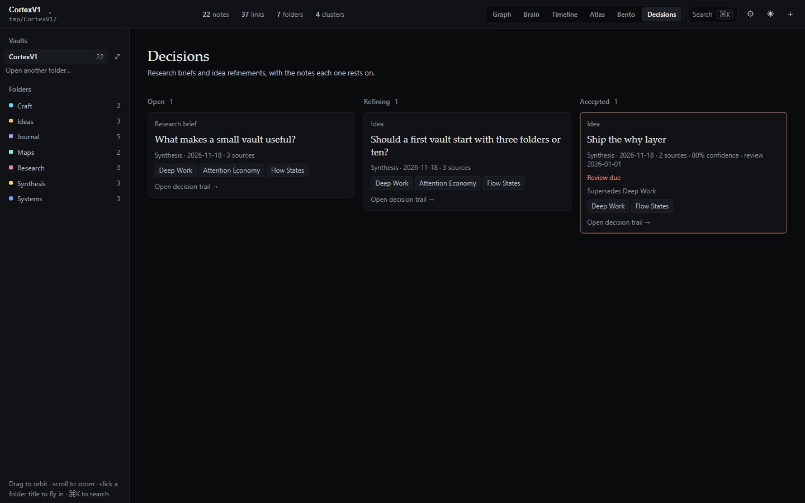
</p>

This is the release. A decision is not a note with a checkbox. It has a
confidence level, a date when it should be looked at again, and a predecessor it
supersedes. Cortex keeps that context in plain frontmatter, so it survives every
editor, every export and every sync folder — and turns your graph into a record
of **how you think**, not just what you saved.

It reads and writes plain Markdown, so an existing Obsidian or Logseq vault
works as-is. Research briefs, idea notes, Decisions and decision trails are
**native Cortex features**: they are built from your notes and frontmatter on
your machine. MCP is an optional bridge for an external AI client, not a
dependency of any view or workflow.

## Native, map, or MCP?

| Capability | What it is | Uses the Atlas map? | Needs MCP/AI? |
| --- | --- | --- | --- |
| Graph, Brain, Timeline, Atlas, Bento | Native views of the same vault scan | Atlas **is** the map | No |
| Search, backlinks, related notes | Native vault features | No | No |
| Research brief / Refine idea | Native Markdown scaffold from selected notes | Only as a note on the map | No |
| Decisions board / decision trails | Native board and panel derived from `type`, `status` and wikilinks | No | No |
| Today’s note | Native file at `Journal/YYYY-MM-DD.md` | No | No |
| External AI client | Optional MCP bridge | No | Yes, separately |

The rest of this README keeps those three ideas separate: **native features**
work on the folder, the **Atlas** is one spatial view, and **MCP** is optional.

## Six views. One question.

The same app at three vault sizes. The small demo is a first-run taste, the
medium one is the full tour, and the giant one is the stress test: **5,523
notes, 24,151 links, 41 folders, zero unresolved links.** Every screenshot
below is a different seeded vault, not a mock-up.

Above 1,200 notes Cortex switches to a folder-level **overview**: notes keep
their real positions, but the graph labels folders instead of a dozen
individual stars, draws only the strongest 5,000 links, and the atlas turns
dense folders into light stipple. Hover or select a note for its own label.
Click a folder title to fly into that galaxy; `All folders` flies back out.

The graph is a sphere of **folder galaxies**: every folder is a local cluster of
note dots, the strongest links stay nearby, and a large daily journal becomes a
chronological ring around the vault instead of a blob that swallows the map.
That is the layout in every screenshot below.

### Small — 21 notes, 35 links

| | |
| --- | --- |
| 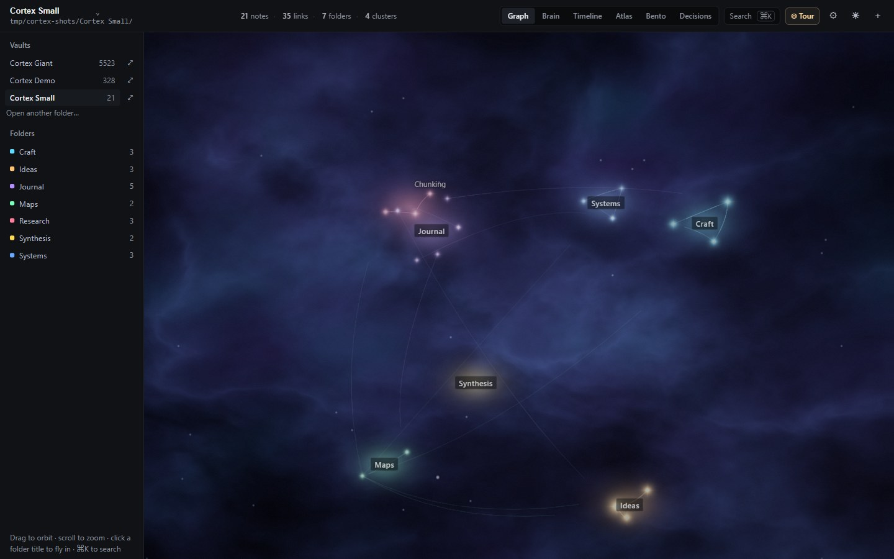 | 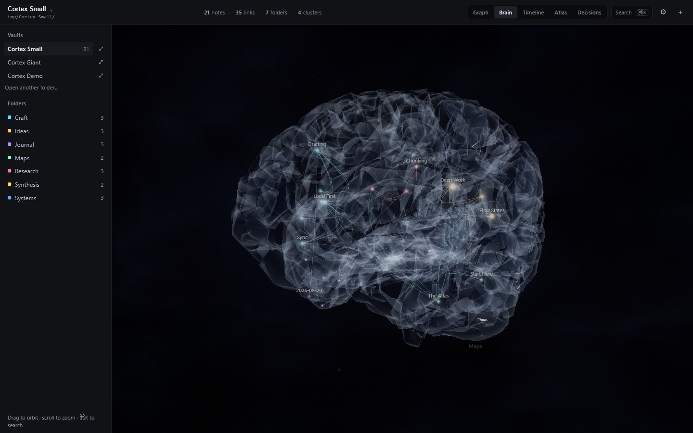 |
| **Graph** — folder galaxies: notes are dots, links are light, and the sky is a nebula. | **Brain** — the same graph inside a real cortical surface. |
| 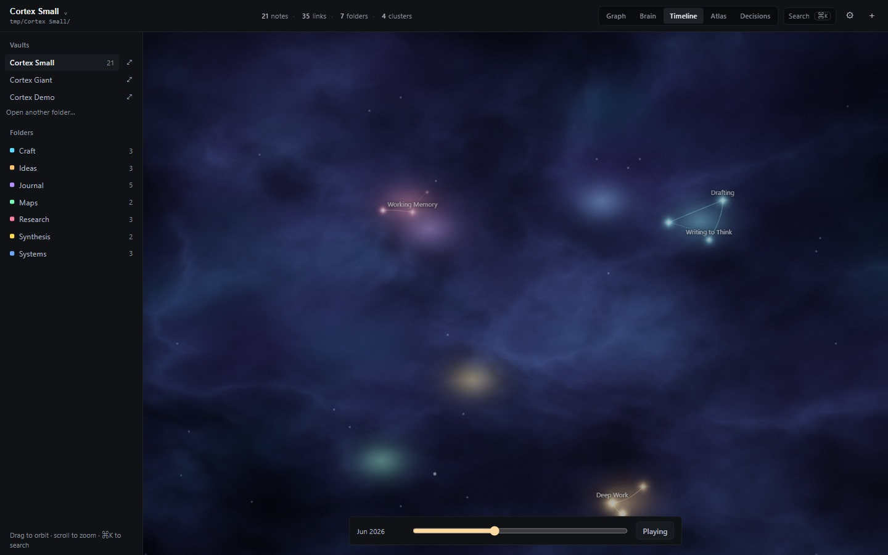 | 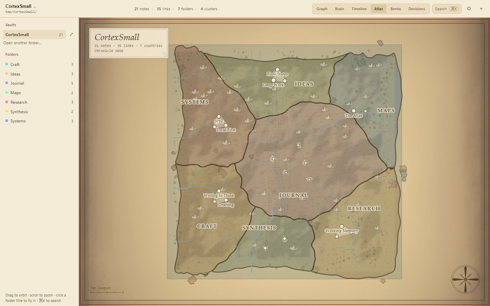 |
| **Timeline** — the vault replayed as it was written. | **Atlas** — seven folders as countries, notes as places, links as roads. |
| 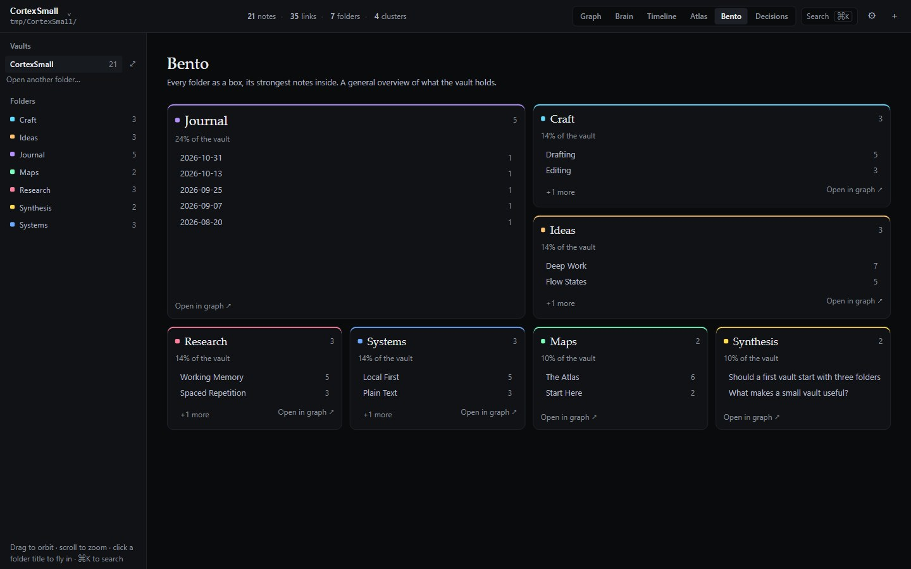 | 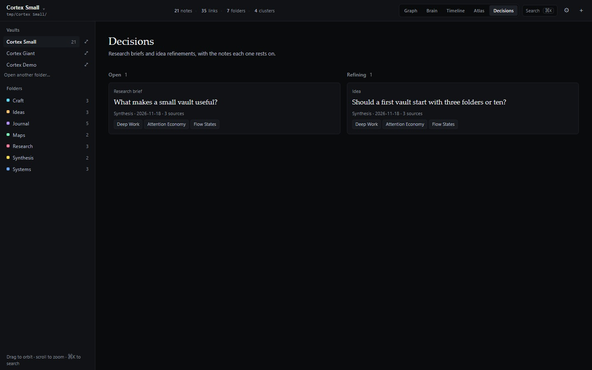 |
| **Bento** — every folder as a box, sized by how much of the vault it holds. | **Decisions** — two starter briefs, grouped by `status`, with their sources. |

### Medium — 328 notes, 557 links

| | |
| --- | --- |
| 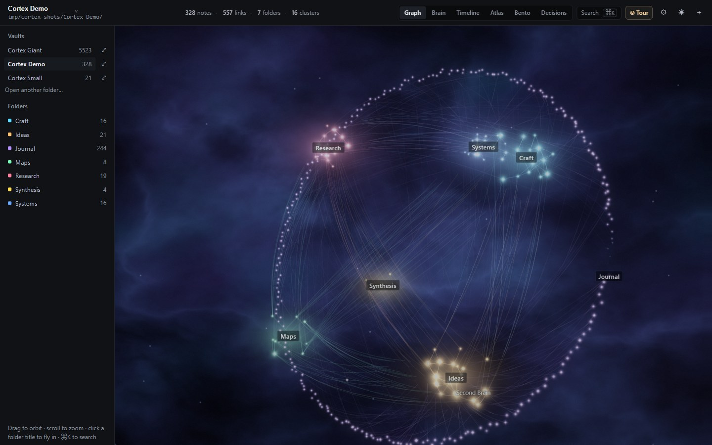 | 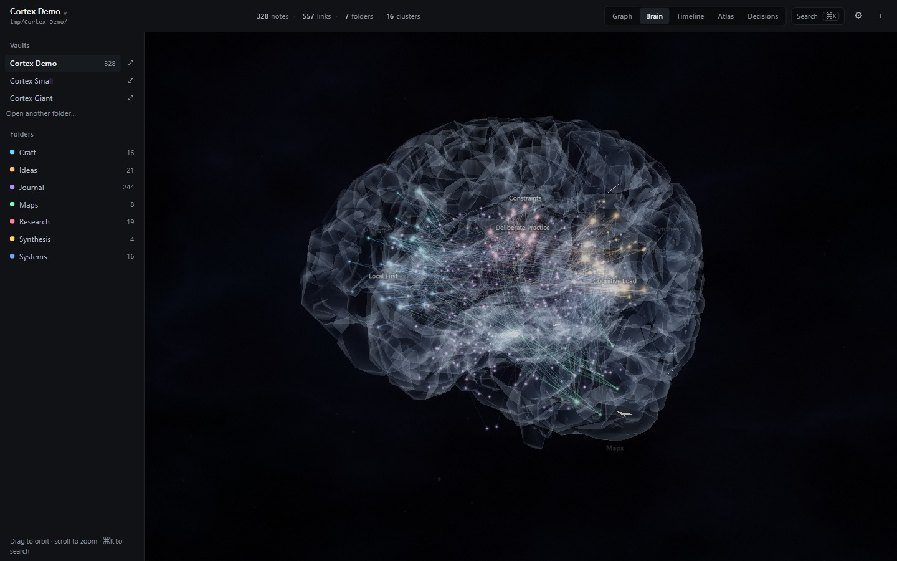 |
| **Graph** — folder galaxies around the journal’s orbit; drag to orbit, scroll to zoom, `f` to reframe. | **Brain** — the same graph inside a real cortical surface, links as fibre tracts. |
| 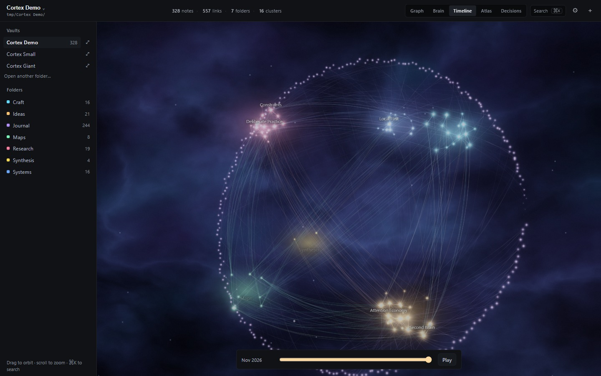 |  |
| **Timeline** — the vault replayed in the order it was written, with a scrubber. | **Atlas** — countries, towns, roads, and rivers that follow the land. |
|  | 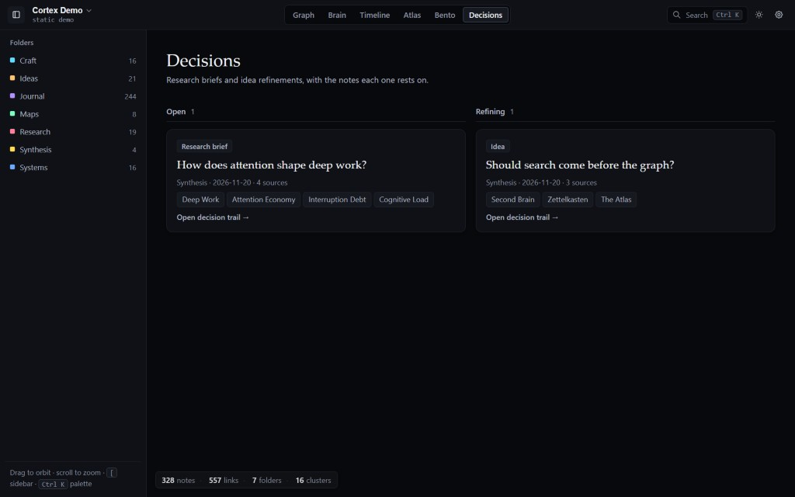 |
| **Bento** — seven folders as boxes, with their strongest notes inside. | **Decisions** — research briefs and idea refinements, grouped by `status`. |

### Giant — 5,523 notes, 24,151 links

| | |
| --- | --- |
| 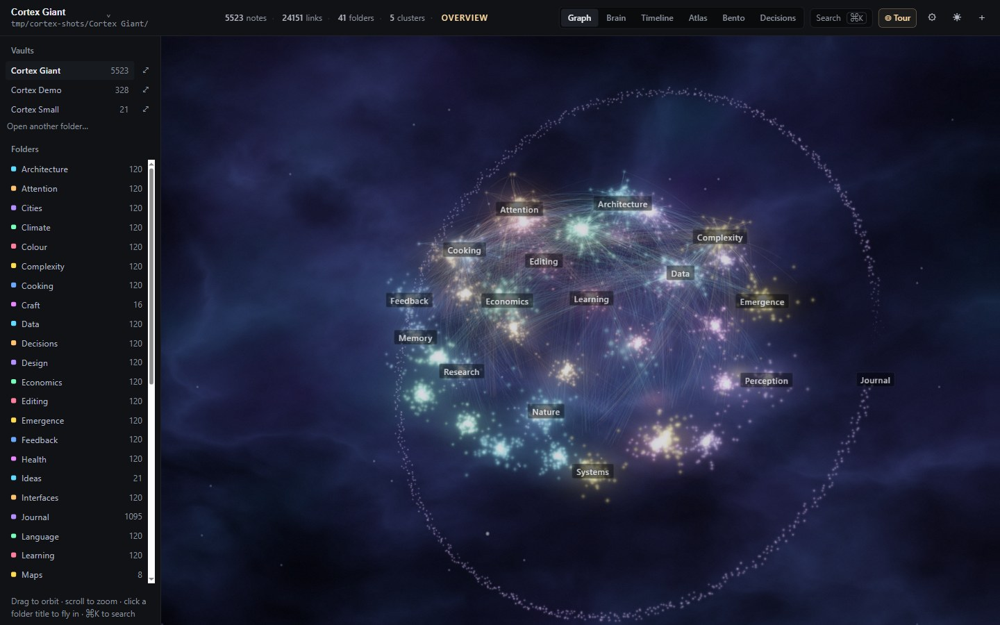 |  |
| **Graph** — 36 labelled topic galaxies over a sphere, plus a three-year daily journal ring. | **Brain** — topic folders on the cortex; diary entries form the core. |
| 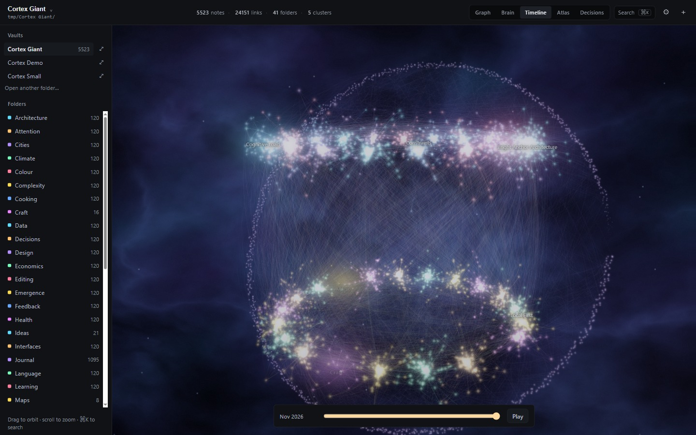 | 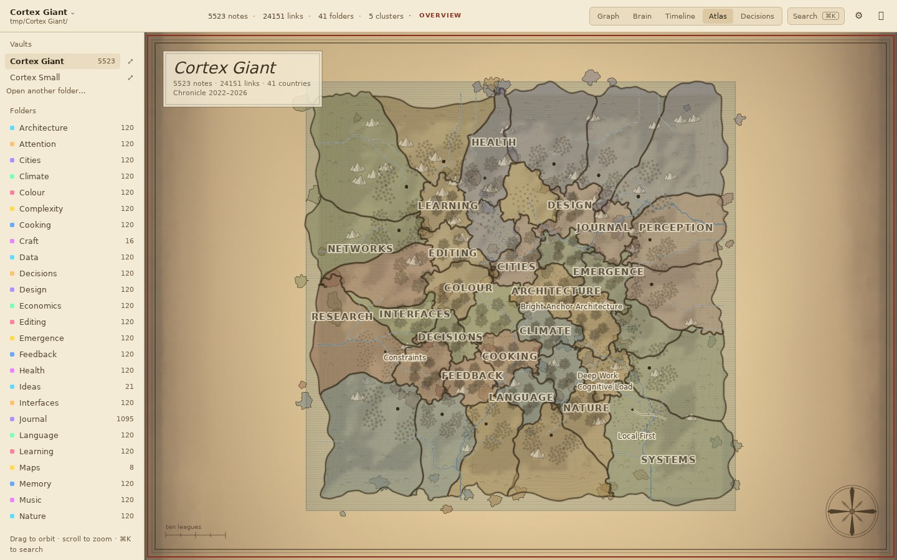 |
| **Timeline** — four years of entries replayed. | **Atlas** — 41 countries; dense folders are stipple, not a wall of black badges. |
| 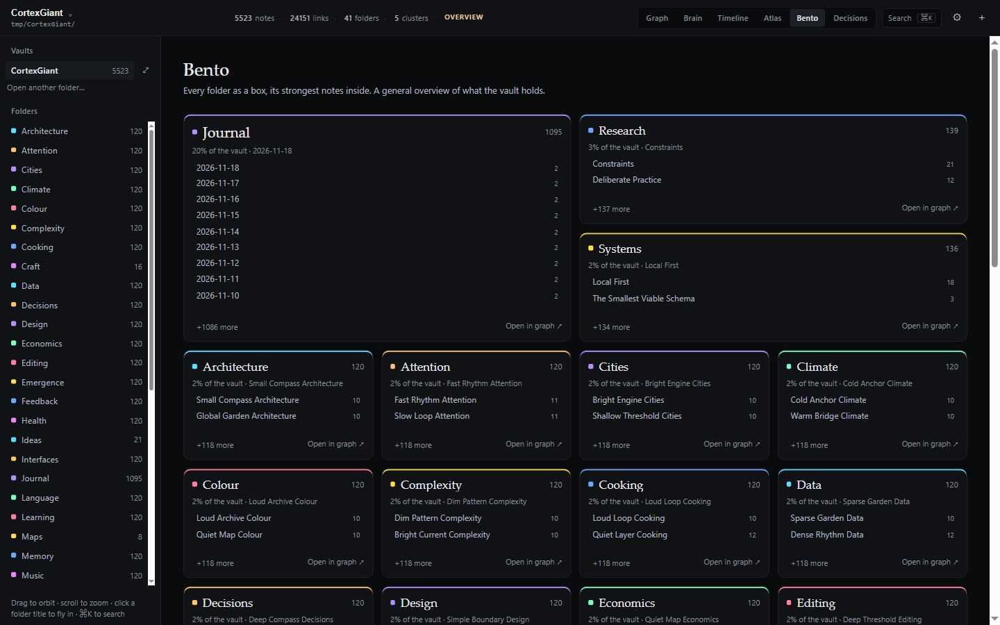 | 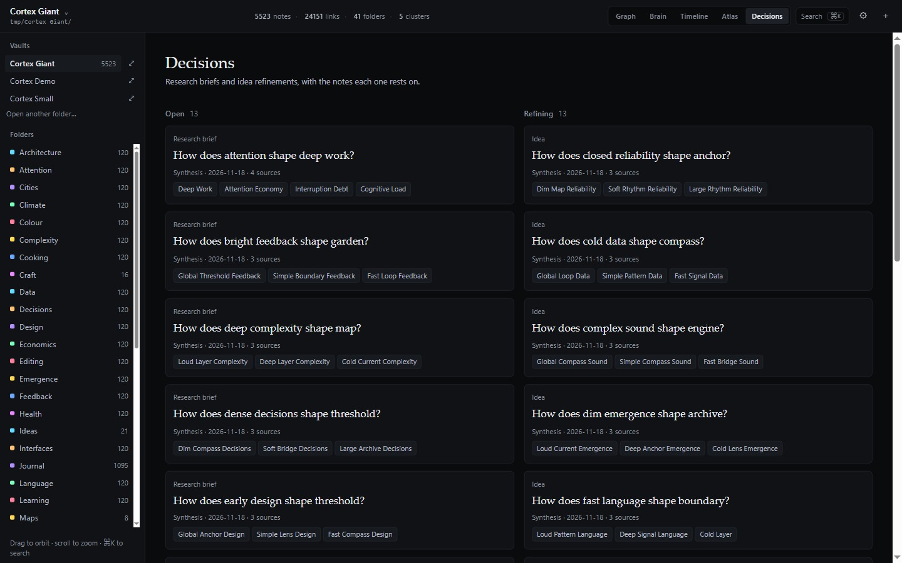 |
| **Bento** — 41 boxes; the 1,095-note journal is the large tile. | **Decisions** — 26 cards across open and refining, each with real sources. |

```bash
cargo run -p cortex                                    # reopens the last vault, or offers a picker
cargo run -p cortex -- seed-demo demo --size small     # 21 notes
cargo run -p cortex -- seed-demo demo --size medium    # 328 notes (default)
cargo run -p cortex -- seed-demo demo --size large     # 5,523 notes
cargo run -p cortex -- serve demo                      # open one folder directly
```

All three vaults are written by `seed-demo` from the binary itself. No demo
vault is downloaded, and nothing is fetched from GitHub at startup.

## Opening a folder

Run `cortex` (or the Start Menu shortcut) and it reopens whatever you used
last. With nothing remembered you get a launch screen: the folders you have
opened before, **Browse…** for the platform's folder dialog, and a path field
for the places a dialog cannot reach (a network share, a WSL path, another
drive).

- Vaults are remembered in `vaults.json` in your platform config directory
  (`$XDG_CONFIG_HOME/cortex`, `~/Library/Application Support/cortex`,
  `%APPDATA%\cortex`). Override it with `CORTEX_CONFIG_DIR`.
- Several vaults can stay open at once. The list on the left switches between
  them without restarting anything; search, synthesis and the palette always
  act on the vault you are looking at.
- Choose the view you land in on the launch screen (**Open in**), or change it
  later from **Vault settings**. Cortex remembers the view per vault.
- `cortex serve <folder>` still opens one in the foreground, and `Ctrl+O`
  (`⌘O` on macOS) returns to the picker. Closing the app window ends the
  background instance; `cortex stop` does it from a terminal, and
  `cortex doctor` says what is running, on which port, with which browser.
- Nothing is copied, moved or synced. Cortex reads the folder in place, and a
  folder that has been moved shows up struck through until you forget it.

### Live updates

A change on disk — your editor, a sync client, another machine — appears in
about 400 ms. Only the changed files are re-parsed, and every note that still
exists keeps its position, so the universe does not rearrange itself while you
work. The tab is notified over a long poll: no refresh button, no page reload.
If the change lands in the note you are editing, Cortex warns instead of
replacing your draft.

## Native setup: research and decisions

This is the part that makes Cortex different, and it does not use the Atlas map
or an AI connection. Cortex builds a deterministic Markdown scaffold from the
notes you select; it does not call a model or write the thinking for you.

1. **Open a folder.** Run `cortex`, choose a vault, or use **Open another
   folder**. Seed a throwaway vault with `cortex seed-demo demo --size small`
   if you want to try the loop first.
2. **Collect at least two notes.** ⌘-click (or shift-click) stars, or open a
   note and press `Collect`. Collected notes stay bright while everything else
dims. The **Collected** tray appears in the sidebar.
3. **Choose a structure note.** In the tray, `Research brief` asks for a
   question and writes `Synthesis/<question>.md`; `Refine idea` asks for the
   decision and writes an idea note in the same folder. Both are ordinary
   Markdown files with frontmatter, a linked evidence list (title, folder,
   excerpt) and the sections you need to fill in. No network request, model or
   API key is involved.
4. **Read and revisit it in Decisions.** Press `5` (or click **Decisions**). The
   new note appears as a card under `open` or `refining`, with the notes it
   cites. Add optional `confidence`, `review_on` and `supersedes` frontmatter
   to turn it into a decision with a due date and a trail.
5. **Open the trail.** Click the card or press `y` in the note to see the
   decision trail, its linked sources and the note it supersedes.

Every claim in the brief is one click from its source, because the evidence
list is made of `[[wikilinks]]`, not copies — and the brief itself joins the
**Decisions** view with those sources on the card. The Atlas is separate: it
renders folders and notes on a map, so a brief appears there as a note like any
other, but Decisions cards are not drawn on the map.

## The idea-refinement loop

Select the notes that carry the tension, then choose `Refine idea`. The scaffold
has situation, assumptions (load-bearing vs cosmetic), two options with effort /
risk / reversibility, a recommendation, and "what would change my mind".

This is the part most note tools leave out: they help you collect and connect,
then stop before a decision exists. Cortex makes the decision artifact a
first-class note in the same graph, and keeps it in **Decisions** until its
`status` says otherwise.

## The atlas

The fourth view is a campaign map for history and worldbuilding: folders become
countries, notes become places inside them, links become roads.

- **Geography is deterministic.** The same vault always grows the same map, so
  a place stays where you learned it.
- **Countries are sized by their contents.** Capitals are packed with a radius
  taken from the folder's note count, and a power diagram moves each shared
  border until cell area matches that count. A 16-note folder becomes a small
  country and the 1,095-note journal a large one, without changing the
  campaign-map look or the welded borders.
- **Borders are shared.** Country outlines are grown from a partition of the
  folder centres and roughened with noise keyed to the *unordered* endpoints of
  each border segment, so two neighbouring countries displace their shared
  border to the same line instead of leaving a seam.
- **Water follows the land.** Rivers are not drawn by hand: a 132×132 height
  model (ridges inland, sea at the coast) is sink-filled and drained by
  steepest descent, and one unit of rain per cell accumulates into streams
  that join, widen and reach the sea.
- **Terrain is engraved, not stamped.** Contour lines, hill shading, mountain
  ranges and woods are all sampled from that same height model, so ranges sit
  where the rivers rise and forests fill the low ground between them.
- **Wilderness is the default.** Land nobody settled is stippled with grass;
  each clump of notes gets a walled enclosure with cleared ground inside it.
  A folder of 240 notes becomes stipple, not a wall of discs.
- **Roads carry weight.** Every link draws a road. A note with more links draws
  a wider road, and a link that crosses a border becomes a dashed trade route.
- **Sea, islands, compass.** The land is pulled in from the frame, ringed with
  a fine sea wash, and dotted with small islands off the coasts.

Drag to pan, wheel or `+`/`-` to zoom, `0` to fit, arrow keys to pan with the
keyboard, click a place to open it. Hiding a folder dims its country and its
roads rather than deleting them.

## Bento

The fifth view answers *what is even in here?* Every folder becomes a box, its
strongest notes are listed inside, and the box is sized by how much of the vault
it holds. A big folder earns a large tile; the rest fill a four-column grid.
Click a note to read it without leaving the board, or **Open in graph** to fly
to that folder's section.

- **Sized by content, not by link rank.** A journal with a thousand entries is a
  big box even when its notes are barely linked to each other.
- **Deterministic.** Folder order and note ranks come from the same scan, so the
  same vault produces the same board on every load and in `cortex export`.
- **DOM only.** The board costs no WebGL frame; switching to it stops the scene
  renderer until you leave.

## Decisions

The last view answers a different question: *what have I concluded, and on
what?* Every note with `type: research` or `type: idea` — the two kinds Cortex
writes — appears as a card, grouped by its `status`.

- `open` and `refining` are the columns Cortex creates. Any other value you
  write in frontmatter becomes its own column, so `answered` or `parked` works
  without Cortex pretending to know what it means.
- A card shows its folder, its date, how many notes it cites, and those notes as
  chips. Click a chip to open the source; click the title to read or edit the
  brief.
- Links that point nowhere are counted on the card instead of being hidden.
- The board is read-only on purpose. `status` is your frontmatter, editable in
  Obsidian, another editor or by an agent: Cortex reports it and does not take
  the field over. Obsidian's Bases already moves cards between columns; what it
  cannot do is show the evidence a decision rests on.
- **The trail.** Add `confidence`, `review_on` and `supersedes` to the
  frontmatter. The card shows confidence and the review date; a past date is
  marked **Review due**. The note panel shows the trail above the prose and the
  linked sources below it. Press `y` to jump back to the trail.
- Empty is a real state. Until you write a brief, the view explains the loop
  instead of pretending to have data.

```yaml
---
type: idea
status: accepted
confidence: 0.8
review_on: 2027-01-15
supersedes: "[[Earlier decision]]"
---
```

All three fields are optional. A plain Markdown note, an Obsidian vault and a
static export keep working without them. The design is recorded in
[ADR 0008](docs/adr/0008-decision-trails.md); the market research is in
[docs/research/v1-note-app-landscape.md](docs/research/v1-note-app-landscape.md).

The board is built from the same vault scan as the graph, so it updates on the
same live poll, works in `cortex export`, and costs one field in the graph
payload rather than a second index.

## Navigating

`Ctrl` on Windows and Linux, `⌘` on macOS.

| Action | Key |
| --- | --- |
| Search every note | `Ctrl K` / `⌘K`, or `/` |
| Back / forward through opened notes | `Ctrl [` / `Ctrl ]` (`⌘[` / `⌘]`), or `‹` `›` in the panel |
| Collect / uncollect a note | `Ctrl` / `⌘` / `Shift` + click, or `c` |
| Focus a note | click it |
| Local neighbourhood | `Local graph` in the note panel, or `l` |
| Fly to a folder / back out | click its title, or `All folders` |
| Views | `1` graph, `2` brain, `3` timeline, `4` atlas, `5` decisions, `6` bento |
| Reset camera | `f` |
| New note / edit | `n`, or `Edit` in the panel |
| Today’s note | `t`, or the sun button in the toolbar |
| Jump to a decision trail | `y` while a research brief or idea note is open |
| Open another folder | `Ctrl O` / `⌘O` |

The folder list toggles visibility; hidden folders dim instead of disappearing,
so the context stays visible. Clicking a `[[link]]`, a backlink or an unlinked
mention opens that note in place, and the arrows walk back through the chain.

## Editing

**Edit** opens the note as plain Markdown in a textarea. It is deliberately not
a rich-text surface: what you type is what gets saved, including frontmatter and
`[[wikilinks]]`.

| Action | Key |
| --- | --- |
| Save / cancel | `Ctrl S` or `Ctrl Enter` / `Esc` |
| Bold, italic, inline code | `Ctrl B`, `Ctrl I`, `Ctrl E` |
| Wikilink | select text, `Ctrl K` |
| Strikethrough, highlight, code block | `Ctrl Shift X`, `Ctrl Shift H`, `Ctrl Shift K` |
| Heading 1–3 | `Ctrl 1`, `Ctrl 2`, `Ctrl 3` |
| Ordered / bullet / task list | `Ctrl Shift 7`, `Ctrl Shift 8`, `Ctrl Shift 9` |
| Blockquote | `Ctrl Shift .` |
| Indent / outdent | `Tab` / `Shift Tab` |

`⌘` replaces `Ctrl` on macOS. Typing `[` inserts `[]` with the caret inside;
parentheses, braces and quotes do the same. If the caret is before a closing
character, typing it steps over instead of adding a duplicate, and backspace
deletes an empty pair. `Enter` continues a list, task or quote marker; pressing
it again on an empty item ends the list.

Today’s note is a normal Markdown file at `Journal/YYYY-MM-DD.md`. Cortex opens
an existing one instead of replacing it; a new one starts with Notes, Decisions
and Tomorrow headings. Add decision metadata to any research brief or idea note
with the optional fields shown above.

## Vault settings

The gear in the toolbar holds the per-vault decisions:

- **Opens in** — which view this vault should start in.
- **Show in folder** — hands the folder to Explorer, Finder or your file
  manager. The same button (⤢) sits beside every vault in the sidebar.
- **Map** — roads and trade routes on the atlas.
- **Agent access** — optional MCP permission: whether an external AI client may
  read and write this vault. Off does not affect search, views, editing,
  research briefs, Decisions or daily notes.

## Optional: connect an AI client (MCP)

**Skip this section for the native workflow above.** Cortex has no built-in
model and does not need an AI client to search, collect, write briefs, refine
ideas, use Decisions or edit notes.

If you already use an AI client, Cortex ships a Model Context Protocol server,
so that client can read the vault, create notes and rewrite sections — through
the same guards the app enforces. This is a separate integration, not the
engine behind research briefs or decisions.

```bash
cortex mcp ~/Notes                    # stdio MCP server bound to one vault
cortex mcp-config --vault ~/Notes     # the snippet, with this binary and this folder
cortex mcp-config --vault ~/Notes --write   # merge it into Claude Desktop and Cursor
```

The printed JSON contains the absolute path to the binary **and** the folder,
so the copy-paste version works. `--write` merges `mcpServers.cortex` into
Claude Desktop and Cursor, backing the file up first and leaving every other
key alone; Zed and everything else get the snippet to paste. Cortex has no
approval step of its own: the AI client decides whether to trust a server, and
most clients only read their config at startup — **restart the client** after
adding it. Vault settings → **AI clients** has the same snippet, a status line
for each client, and **Test connection**, which really starts `cortex mcp`,
initializes it and lists its tools.

Without an argument `cortex mcp` binds to the vault you opened last.

| Tool | What it does |
| --- | --- |
| `cortex_guide` | House format and the rules; an agent should read it first |
| `cortex_stats` | Note and link counts, folders, orphans, unresolved links |
| `cortex_search` | Full-text search with snippets |
| `cortex_read_note` | Body, tags, headings, and the hash a write needs |
| `cortex_create_note` | New note in a folder, slugged from the title |
| `cortex_write_note` | Replace a whole body (`expect` required) |
| `cortex_replace_section` | Replace one section, keep the rest |
| `cortex_append` | Add a block at the end |
| `cortex_move_note` | Rename or refile a note |
| `cortex_links` | Backlinks, outgoing links, unlinked mentions |
| `cortex_orphans` | Notes with no links in either direction |
| `cortex_list_vaults`, `cortex_use_vault` | Same process, another folder |

Every write must present the hash from `cortex_read_note`. If the file changed
in between, the write fails with a conflict and the current hash instead of
clobbering the note you have open in Obsidian. There is no delete tool,
`.obsidian/` and paths outside the vault are refused, and each write is
appended to `agent-writes.jsonl` in the config directory. The instructions an
agent actually receives are in `docs/agent-guide.md`; the reasoning is in
[ADR 0003](docs/adr/0003-agent-access.md).

Access is a per-vault switch. It is on for a vault you have opened in Cortex and
off for a folder Cortex has never seen, so naming a path on the command line is
not a way around it. Turn it off in vault settings, or with
`cortex agents ~/Notes --off`; `cortex mcp` then refuses to start, and a client
that is already connected is stopped on its next call. Turning it back on needs
one of those two, not a restart.

## Run it on your own vault

```bash
cargo run -p cortex -- serve ~/Notes --title "My vault"
```

| Flag | Meaning |
| --- | --- |
| `--open` | open the UI in your browser once the server is up |
| `--app` | open a chromeless app window (Chrome, Edge, Brave) instead of a tab |
| `--read-only` | serve without write endpoints (switching folders still works) |
| `--bind 0.0.0.0` | expose on the LAN (loopback is the default) |
| `--allow-any-origin` | relax the same-origin check (LAN preview) |
| `--allow-framing` | allow embedding in an iframe |
| `--port` | default 3000 |

`cortex export <vault> --out dist` writes a static, read-only site plus
`graph.json` (note bodies included). `cortex index <vault>` prints vault health.

Because opening a folder reads it, it is gated by the `x-cortex` write header
and the same-origin check rather than by `--read-only`. Combined with
`--allow-any-origin` that means anyone who can reach the server can point it at
any folder the process can read — which is why the default is loopback-only.

## What 1.1 is

Cortex 1.1.1 is the local-first version: your folder, plain Markdown, six views,
decision trails, the guided tour, the MCP bridge and the Windows installer.

It deliberately does **not** include a hosted sync service, a mobile app,
real-time collaboration, a plugin runtime, a block editor or a built-in AI
model. Use the folder with iCloud, Dropbox, Syncthing or Git if you want it on
more than one machine. The boundary is part of the product: no account, no
proprietary database, no telemetry.

The UI still has no build step. Every screenshot in this README is a seeded
vault rendered by the app, not a mock-up.

## Get Cortex 1.1.1 — The Guided Tour

**One folder. Six views. A reason for every decision.**

**Installer:** `CortexSetup-<version>.exe` — per user, no admin, Start Menu
entry, uninstaller, optional start-at-login. **Portable:**
`cortex-windows-x86_64.zip`, unpack and run `cortex.exe`. Both from
https://github.com/thijnperd/obsidian-cortex/releases

| Platform | File |
| --- | --- |
| Windows x86-64 | `CortexSetup-<version>.exe` or `cortex-windows-x86_64.zip` |
| macOS (Apple silicon) | `cortex-macos-arm64.tar.gz` |
| Linux x86-64 | `cortex-linux-x86_64.tar.gz` |

Tagged releases are fixed; every push to `main` also refreshes the rolling
`latest` build. The current release is **v1.1.1 — The Guided Tour**. The version
appears in `cortex --version`, in **Vault settings → About**, and on
`/api/about`. `SHA256SUMS.txt` is attached to every release.

### Windows says it is unsafe

The executable is unsigned, so SmartScreen shows *Windows protected your PC* on
the first run: **More info → Run anyway**. The full walk through, including
uninstall and checksum verification, is in
[installing on Windows](docs/install-windows.md).

### Updates

Cortex checks its release feed once when it starts, and again from **Check for
updates** in About. A newer stable tag appears as a small notice above the
graph: **Update** on Windows, **Download** on macOS and Linux.

The Windows path downloads `CortexSetup-<version>.exe`, verifies it against that
release's `SHA256SUMS.txt`, runs the installer silently, and reopens Cortex. It
never installs a build whose checksum does not match. macOS and Linux open the
release page instead: replacing a running Unix binary safely needs its own
mechanism, and pretending an archive can do it is how data gets lost. The check
reads the public Atom feed for releases, not the rate-limited GitHub API.

### What starts when you run `cortex`

One process owns the server, the window and (on Windows and macOS) the tray
icon. It starts in the background, so the terminal comes straight back and
closing it changes nothing. Closing the window ends the instance; **Quit
Cortex** in the tray does the same. If port 3000 is taken it takes the next free
port, records it in `server.json`, and a second launch opens a window against
the running instance instead of dying on a bind error. `cortex stop` ends it,
`cortex doctor` explains it.

The window is Chrome, Edge or Brave in `--app` mode with a profile of its own —
a chromeless window without shipping a second runtime. Without one of those
browsers you get a normal tab, and closing that tab cannot end the instance, so
use the tray or `cortex stop`. Linux has no tray: it runs until `cortex stop`.

Or point it straight at a folder, in the foreground:

```bash
cortex serve ~/Documents/MyVault --open
```

## Design constraints

- **The files are the app.** Frontmatter, wikilinks, tags and headings are the
  only schema; no proprietary format. Deleting the vault is the uninstall.
- **The graph must earn its place.** It is for orphans, clusters, and local
  neighbourhoods — not for reading the whole vault at once. That is why focus
  and filters exist.
- **Writes are opt-in.** Loopback by default, custom header plus exact-origin
  check, path validation, atomic writes, 1 MiB caps, strict CSP.
- **Deterministic.** Same vault, same layout, so places stay memorable.

## Develop

```bash
cargo test -p cortex-core
cargo clippy --workspace --all-targets -- -D warnings
cargo fmt --all --check
```

## When something is wrong

```bash
cortex doctor     # version, config and log paths, live instance, port,
                  # browser, every vault and its agent switch, MCP clients
cortex stop       # ask the background instance to exit
```

The background process writes `<config>/cortex.log`; the tray's **Show log**
opens it, and it rotates once at 1 MiB. A busy port is no longer an error: the
next free one is chosen and printed. If `cortex` says nothing at all, run
`cortex app` in a terminal — it is the same process with its output attached.

The workflow design is grounded in primary documentation from Obsidian,
Logseq, Heptabase, Roam, Zettelkasten and Forte Labs; the notes and sources are
in [`docs/research-workflows.md`](docs/research-workflows.md).

`crates/core` is pure logic (parse, index, layout, search, synthesis);
`crates/server` is axum plus the embedded `web/` UI, which is hand-written
WebGL2 with no build step. CI runs the checks on Linux, macOS and Windows and
publishes the static export to GitHub Pages.

## License

Cortex is MIT licensed. See [LICENSE](LICENSE). Security reports follow
[SECURITY.md](SECURITY.md), and the v1.1.1 release notes are drafted in
[docs/releases/v1.1.1.md](docs/releases/v1.1.1.md).

## Credits

The Brain view's cortical surface is a simplified version of the
[Detailed Human Brain Model](https://3d.nih.gov/entries/3DPX-021161) from NIH 3D
(Johnson J), used under [CC BY 4.0](https://creativecommons.org/licenses/by/4.0/).
It was reduced from 377,701 to 20,018 triangles for the renderer.
