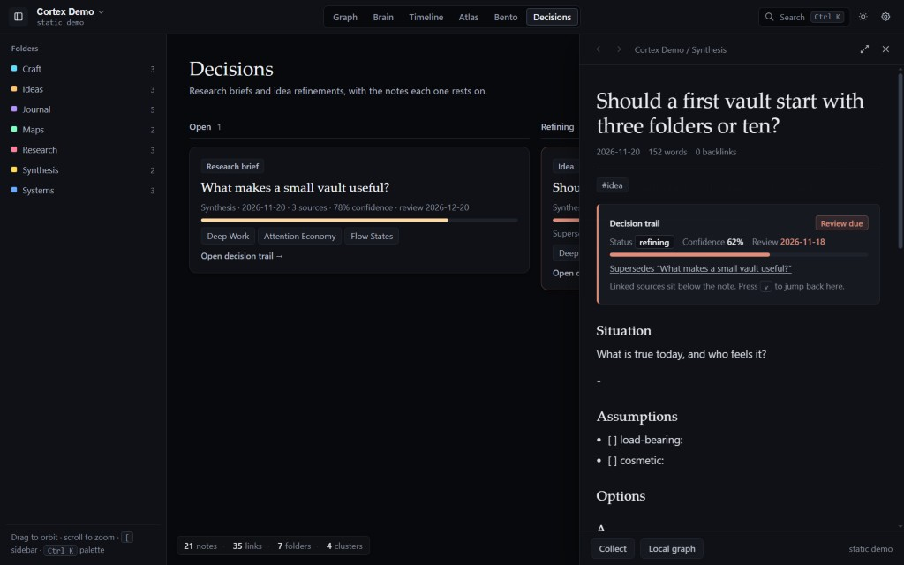

# Cortex 1.0 — Find the Why

**Your notes have a shape. Cortex shows you the reason.**



Most note tools help you collect. Cortex helps you conclude.

Cortex 1.0 turns a folder of Markdown into a local-first thinking space with six
views of the same graph — a 3D universe, a brain, a timeline, an atlas, a bento
board, and a Decisions board that remembers why the important conclusions
exist. No account. No cloud. No database. No model required.

## The reasoning trail

This is the release. A decision is not a note with a checkbox. It has:

- a **confidence** level,
- a **review date** that can come due,
- the note it **supersedes**,
- and the evidence it rests on.

Add three optional fields to plain frontmatter. The Decisions board surfaces
what needs another look; the note panel shows the whole trail, with every source
one click away. Press `y` to return to it.

Nothing is mandatory. Existing Obsidian and Logseq vaults open as-is; plain
notes stay plain notes.

## A thinking space, not a workspace

- **Six views, one graph.** See where a note lives, what it touches, and what
  the whole vault is made of.
- **Native research and idea briefs.** Collect two or more notes; Cortex writes
  a Markdown scaffold with linked evidence. You supply the thinking.
- **Today's note.** Press `t` to open or create `Journal/YYYY-MM-DD.md` with
  Notes, Decisions and Tomorrow sections.
- **An editor built for Markdown.** Bracket pairing, Obsidian-style formatting,
  list continuation, headings, quotes and save/cancel shortcuts.
- **A Bento board that reads at a glance.** Readable type, roomy cards, no
  clipped source lists.

## Local-first is the product

- Your folder, your files, your frontmatter.
- No account, cloud, telemetry, plugin runtime or built-in AI.
- Use iCloud, Dropbox, Syncthing or Git for multi-machine sync.
- MIT licensed, with a public security policy and changelog.
- Windows installer, portable Windows build, macOS Apple-silicon archive and
  Linux x86-64 archive, plus `SHA256SUMS.txt`.

## Install

Download the build for your platform from the assets below. Windows users can
run the per-user installer with no admin rights; portable and Unix archives
unpack to a single `cortex` binary.

Then:

```bash
cortex                 # open the last vault, or choose a folder
cortex seed-demo demo  # a 328-note vault to try the loop
cortex serve ~/Notes   # open a folder directly
```

Read the [native research setup](https://github.com/thijnperd/obsidian-cortex#native-setup-research-and-decisions)
and the [v1 scope](https://github.com/thijnperd/obsidian-cortex#what-10-is).

**Full changelog:** [v0.9.0...v1.0.0](https://github.com/thijnperd/obsidian-cortex/compare/v0.9.0...v1.0.0)
