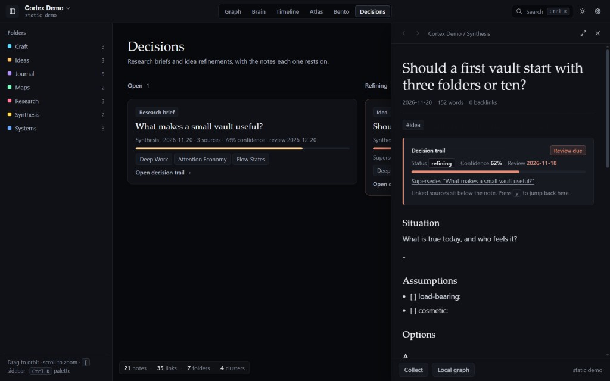

# Cortex 1.1 — The Guided Tour

**Your notes have a shape. Cortex shows you the reason.**



Cortex 1.1 makes the whole loop visible. Press **Tour** and Cortex walks you
through the app in fifteen steps — all six views, collecting evidence, a
research brief, an idea refinement, Decisions and the decision trail.

The tour uses your own vault when it contains the pieces it teaches: a research
brief, an idea note and a decision trail. If your vault does not have all three
yet, Cortex opens a small generated **Cortex Tour** demo instead. When you
finish, it returns you to the vault you started in. Your notes are never written
to or changed.

## What the tour covers

- **Graph, Brain, Timeline, Atlas and Bento** — what each view is for, and how to
  move through it.
- **Collect evidence** — the tray that turns notes into sources.
- **Research brief and Refine idea** — what Cortex writes, and which sections
  you fill in. No prompt, API key or model is involved.
- **Decisions** — status columns, evidence chips, missing links and why the
  board is read-only.
- **The decision trail** — confidence, review dates, `Review due`,
  `supersedes`, and the sources a conclusion rests on.
- **The daily loop** — today's note, editing and the shortcuts that keep it
  fast.

The small demo now ships with a review-due decision and a superseded decision,
so the tour can point at a real trail rather than describing empty fields.

## Local-first, still

- Your folder, your files, your frontmatter.
- No account, cloud, telemetry, plugin runtime or built-in AI.
- The generated tour demo lives in Cortex's config folder, not in your vault.
- Windows installer, portable Windows build, macOS Apple-silicon archive and
  Linux x86-64 archive, plus `SHA256SUMS.txt`.

## Install

Download the build for your platform from the assets below. Windows users can
run the per-user installer with no admin rights; portable and Unix archives
unpack to a single `cortex` binary.

```bash
cortex                 # open the last vault, or choose a folder
cortex seed-demo demo  # a 328-note vault to try the loop
cortex serve ~/Notes   # open a folder directly
```

Read the [guided tour section](https://github.com/thijnperd/obsidian-cortex#new-here-take-the-tour)
and the [native research setup](https://github.com/thijnperd/obsidian-cortex#native-setup-research-and-decisions).

**Full changelog:** [v1.0.0...v1.1.0](https://github.com/thijnperd/obsidian-cortex/compare/v1.0.0...v1.1.0)
