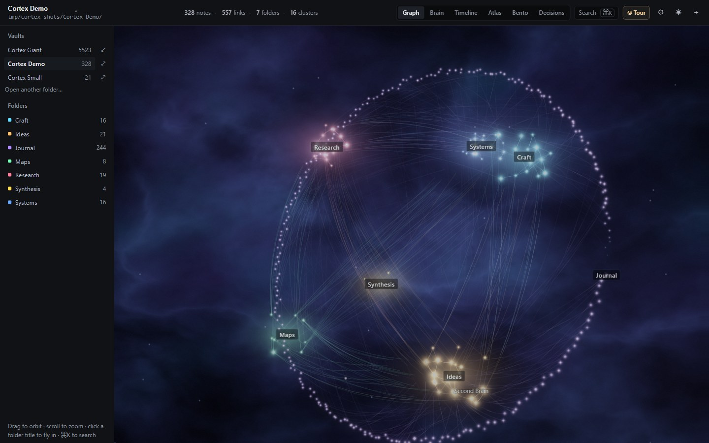

# Cortex 1.1.1 — The Guided Tour

**Replay the tour. See the graph as it is now.**



Cortex 1.1.1 is a patch release for the guided tour and the README's graph
views. The renderer is unchanged: it uses the folder-galaxy layout, with local
clusters of note dots and a chronological ring for a large journal. The README
still showed graph screenshots captured before that layout landed; the
screenshots now come from this build at all three demo sizes.

## What changed

- **Replay the tour.** After the final step, Cortex remembers that the tour was
  finished and changes the toolbar button from **Tour** to **Replay**. The
  marker lives in this browser; closing early does not set it.
- **Current graph views.** The small, medium and giant graph screenshots in the
  README now show the same app the binaries ship: folder galaxies, local
  clusters, note dots, and the journal ring.
- **Clearer documentation.** The README now names the folder-galaxy layout and
  calls out that the images are seeded vaults rather than mock-ups.

## Local-first, still

- Your folder, your files, your frontmatter.
- No account, cloud, telemetry, plugin runtime or built-in AI.
- Windows installer, portable Windows build, macOS Apple-silicon archive and
  Linux x86-64 archive, plus `SHA256SUMS.txt`.

## Install

Download the build for your platform from the assets below. Windows users can
run the per-user installer with no admin rights. The portable Windows and Unix
archives contain a `cortex` executable and a short README.

```bash
cortex                 # open the last vault, or choose a folder
cortex seed-demo demo  # a 328-note vault to try the loop
cortex serve ~/Notes   # open a folder directly
```

Read the [guided tour section](https://github.com/thijnperd/obsidian-cortex#new-here-take-the-tour)
and the [native research setup](https://github.com/thijnperd/obsidian-cortex#native-setup-research-and-decisions).

**Full changelog:** [v1.1.0...v1.1.1](https://github.com/thijnperd/obsidian-cortex/compare/v1.1.0...v1.1.1)
