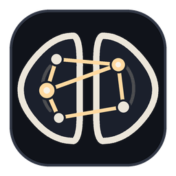

# Cortex 1.2 — The Native Window

**A real app, a real mark, and a launcher that looks like it belongs.**



Cortex 1.2 replaces the Chromium `--app` window with a native one. On Windows
the UI runs in WebView2; on macOS it runs in WKWebView. The server, the origin,
the CSP and every guard are the same — the app is simply the thing that owns
the frame now. There is no Chrome profile, no `--app` flag, no second browser
process to guess the lifetime of.

## What changed

- **A native window.** `wry` + `tao`, not Tauri: the UI is already an HTTP app,
  so the framework would have been a bundler around an existing server. The
  window has its own icon, a minimum size and a navigation guard that sends
  external links to your browser.
- **A tray that belongs to the app.** Open Cortex, Open in browser, Show log,
  agent status and Quit, in the same event loop as the window.
- **The mark.** A lobed brain with the thinking trail cut out of it, drawn once
  in `tools/make-icons.py` and exported as `.ico`, `.icns`, PNGs and tray
  glyphs. The Windows exe, installer, taskbar, macOS bundle and README all use
  it.
- **A launcher worth opening.** The first screen now leads with the mark, a
  clear promise, recent vaults with their note counts and the folder field. The
  six view choices and the generated tour are unchanged.
- **Windows packaging.** The installer and the exe carry the icon; the macOS
  archive is now a `Cortex.app` bundle with `Info.plist` and `cortex.icns`.

## Linux, honestly

Linux keeps the browser path in 1.2. Wry links WebKitGTK 4.1, GTK 3 and
libsoup 3, and a missing WebKitGTK stops the binary before it can print
anything. Shipping a native window there means making WebKitGTK a documented
package dependency; that is a separate release, not a quiet regression.

## Install

Download the build for your platform from the assets below.

```bash
cortex                 # open the last vault, or choose a folder
cortex seed-demo demo  # a 328-note vault to try the loop
cortex serve ~/Notes   # open a folder directly
```

The Windows installer is per user and needs no admin rights. macOS ships
`Cortex.app` inside `cortex-macos-arm64.tar.gz`; it is ad-hoc signed, so a
downloaded copy still needs the usual Gatekeeper approval until notarization
is set up. Linux ships the self-contained binary.

**Full changelog:** [v1.1.1...v1.2.0](https://github.com/thijnperd/obsidian-cortex/compare/v1.1.1...v1.2.0)
