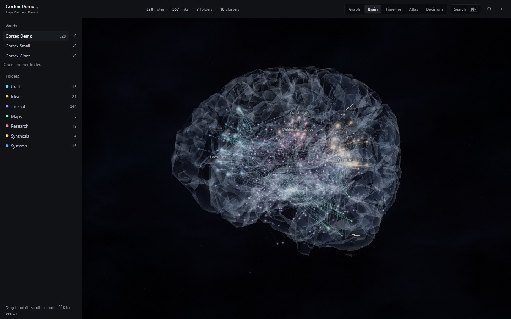
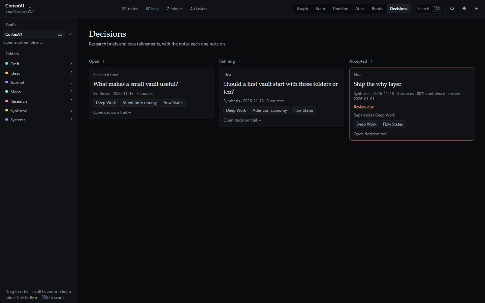

# Cortex 1.3 — Your Notes, as a Brain

**The Brain view is now the front door, and the mark finally looks like it.**



Cortex is named after the cortex, so 1.3 stops burying the best view below a
decision-board banner. The README, the social card and the live demo all open on
the Brain: 328 notes, 557 links, one cortical surface, links drawn as fibre
tracts. Decisions are still here — they are the proof that the shape is not
decoration — but they are the second beat now.

## What changed

- **Brain-first README and demo.** The hero is a real Brain screenshot, not a
  mock-up. The live demo link uses `?view=brain`, so the first click lands in the
  Brain. `?view=` accepts every named view.
- **A mark that survives 16px.** The icon is redrawn from the supplied mark: one
  solid, four-lobed brain silhouette, a vertical seam and a single double-band
  thinking trail. The scalloped cloud outline and the hairline spiral artifacts
  are gone. PNGs, `.ico`, `.icns`, tray glyphs, the window icon, the README mark
  and the favicon all come from the same geometry.
- **Tabler icons in the chrome.** Toolbar and panel glyphs are inline Tabler
  icons, bundled as a sprite. No network request, no font dependency.
- **Keys for the OS you are on.** Shortcut hints now render as `⌘K` on macOS and
  `Ctrl K` on Windows and Linux. The other platform's modifier is no longer
  shown.
- **The positioning is written down.** `docs/marketing.md` records the
  brain-first hierarchy, the options considered and what would change the
  decision. `docs/research/v1.3-brain-first.md` collects the primary sources.

## The proof: decisions

The Brain is the hook; the decision trail is why it is not decoration. The
board still carries confidence, review dates and supersession, and every trail
is an ordinary note you can read in any editor.



## Linux, honestly

Linux still uses the browser path in 1.3. Wry would link WebKitGTK 4.1, GTK 3
and libsoup 3 into a binary that is currently self-contained; that trade is
recorded in ADR 0009 and left to a later release.

## Install

Download the build for your platform from the assets below.

```bash
cortex                 # open the last vault, or choose a folder
cortex seed-demo demo  # a 328-note vault to try the loop
cortex serve ~/Notes   # open a folder directly
```

The Windows installer is per user and needs no admin rights. macOS ships
`Cortex.app` inside `cortex-macos-arm64.tar.gz`; it is ad-hoc signed, so a
downloaded copy still needs the usual Gatekeeper approval until notarization is
set up. Linux ships the self-contained binary.

**Full changelog:** [v1.2.0...v1.3.0](https://github.com/thijnperd/obsidian-cortex/compare/v1.2.0...v1.3.0)
