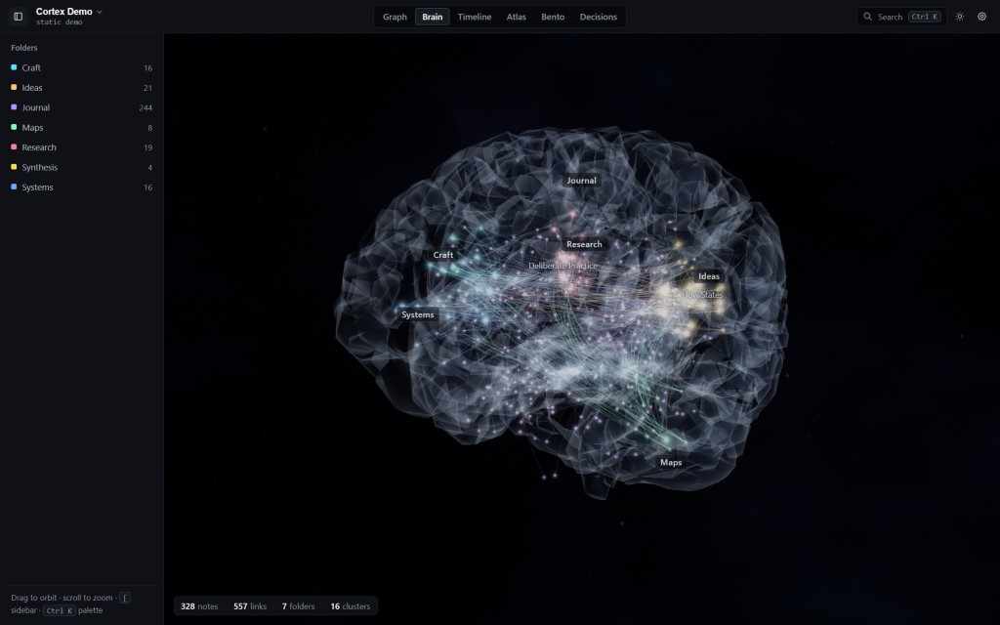
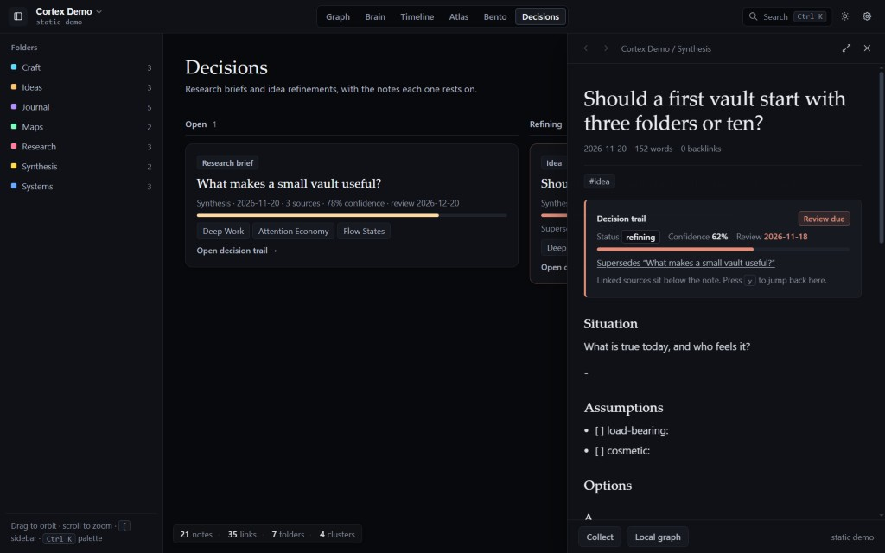

# Cortex 2.0 — Precision Editorial Studio

**A quieter, resizable studio shell, Warm Light & Dark themes, a unified Command Palette, and a dedicated product page for the live demo.**



Cortex 2.0 upgrades the entire frame around the six views without giving up what made Cortex fast and trustworthy: zero build step, strict CSP, deterministic layouts, and plain Markdown files in place.

## What changed

- **Precision Editorial Studio aesthetic.** Deeper tonal layering, subtle hairline elevation, tabular figures, and sharper hierarchy across the toolbar, sidebar, Launch screen, Decisions cards, and Bento boxes.
- **Dark, Warm Light & System themes.** Switch appearance from the toolbar or Vault settings without flash of unstyled content. Atlas keeps its cartographic parchment palette across all themes, while Brain, Graph, and Timeline keep their deep obsidian stage so stars and fibre tracts stay sharp.
- **Collapsible & drag-resizable workspace.** Collapse the sidebar with `[` or the toolbar toggle, drag-resize both the sidebar and the note panel (double-click to reset), and keep vault stats in a quiet bottom-left status pill instead of crowding the top bar.
- **Studio Reader & compact Edit bar.** Expand any note into a centered Focus reader, browse Sources / Backlinks / Mentions / Related in accessible tabs, inspect visual confidence meters on Decision trails, and format Markdown with a compact Edit toolbar backed by native undo.
- **Unified Command Palette (`Ctrl K` / `⌘K`).** Search notes and trigger actions (views, theme, sidebar, reframe, today's note, tour, settings) from one overlay; type `>` to filter commands only.
- **Dedicated GitHub Pages landing site.** `https://thijnperd.github.io/obsidian-cortex/` now opens a zero-build product page with an interactive 6-view showcase and OS-aware downloads, while the live demo moves to `/demo/` with automatic redirects for existing `?view=` links.



## Install

Download the build for your platform from the assets below.

```bash
cortex                 # open the last vault, or choose a folder
cortex seed-demo demo  # a 328-note vault to try the loop
cortex serve ~/Notes   # open a folder directly
```

**Full changelog:** [v1.3.0...v2.0.0](https://github.com/thijnperd/obsidian-cortex/compare/v1.3.0...v2.0.0)
